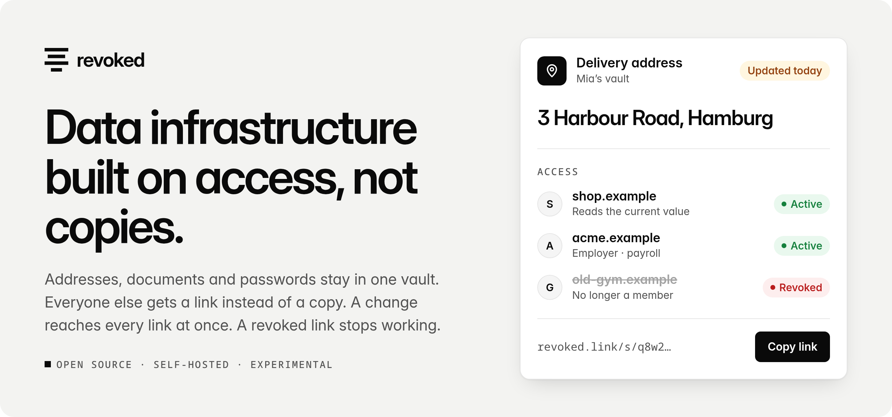
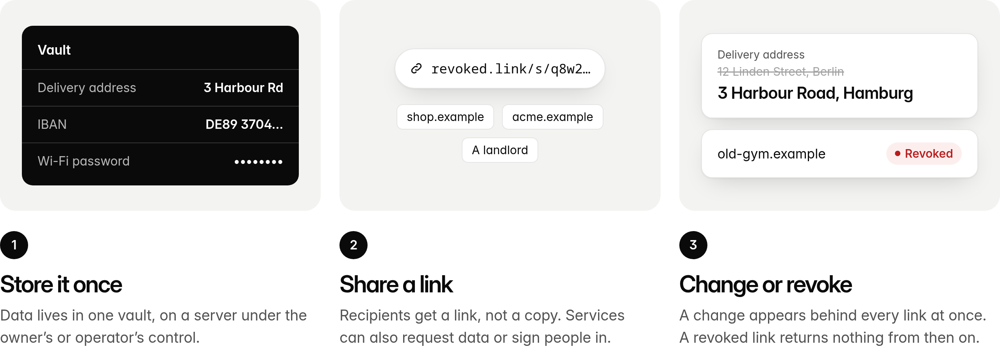
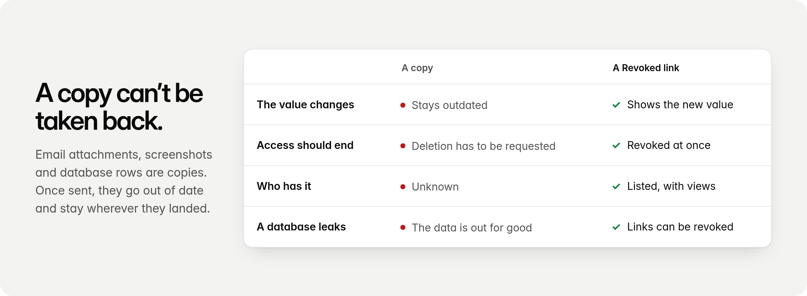
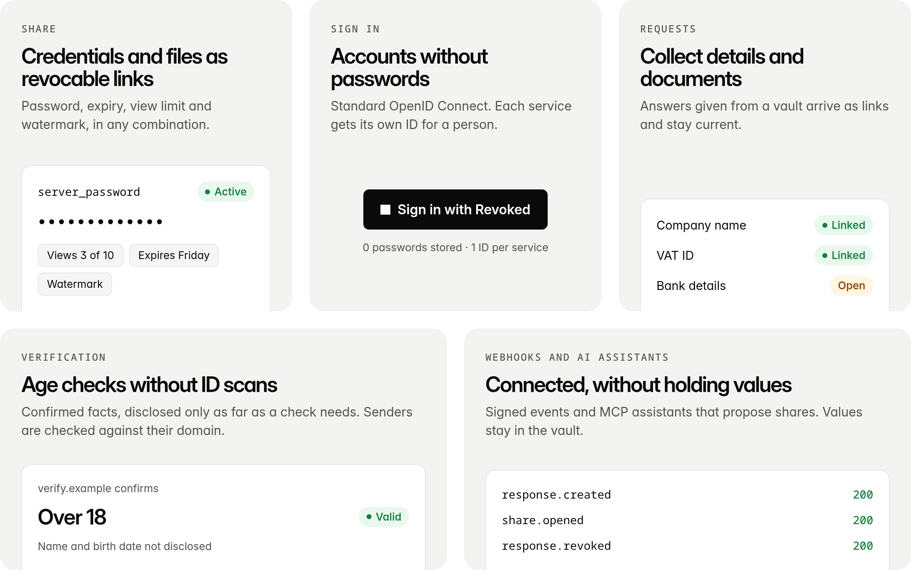
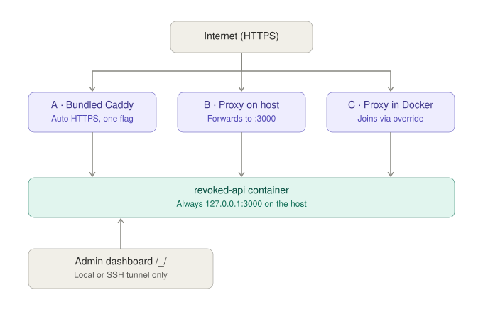

<div align="center">

<a href="https://revoked.link">
  <picture>
    <source media="(prefers-color-scheme: dark)" srcset="docs/assets/readme/hero-dark.png">
    
  </picture>
</a>

<br>

**[Website](https://revoked.link)** &nbsp;·&nbsp; **[Docs](https://docs.revoked.link)** &nbsp;·&nbsp; **[Install the app](https://github.com/argseby/revoked/releases/latest)** &nbsp;·&nbsp; **[Developer API](https://docs.revoked.link/api/)** &nbsp;·&nbsp; **[Films](https://revoked.link/#film)**

[](LICENSE)
[](#try-it)
[](https://github.com/argseby/revoked/releases/latest)
[](https://github.com/argseby/revoked/releases/latest)
[](https://github.com/argseby/revoked/releases/latest)

<sub>BUILT ON OPEN STANDARDS &nbsp;·&nbsp; OpenID Connect &nbsp;·&nbsp; Passkeys &nbsp;·&nbsp; SD-JWT VC &nbsp;·&nbsp; Token Status List &nbsp;·&nbsp; CardDAV &nbsp;·&nbsp; OpenAPI 3.1</sub>

</div>

> [!WARNING]
> Experimental software. The test server at `api.revoked.link` is for test data;
> production use means a self-hosted server under an own domain.

## How it works

**Like sharing a document. For any data.** One original, many links, and a list
of who can open it. Revoked applies that to addresses, bank details, passwords,
files and sign-ins.

<picture>
  <source media="(prefers-color-scheme: dark)" srcset="docs/assets/readme/how-it-works-dark.png">
  
</picture>

## Why a link

<picture>
  <source media="(prefers-color-scheme: dark)" srcset="docs/assets/readme/why-a-link-dark.png">
  
</picture>

## Products

**Everything around one vault.** Each building block works in the app and
through the same public API.

<picture>
  <source media="(prefers-color-scheme: dark)" srcset="docs/assets/readme/products-dark.png">
  
</picture>

<p align="center">
  <a href="https://docs.revoked.link/guide/sharing/">Sharing</a> &nbsp;·&nbsp;
  <a href="https://docs.revoked.link/api/sign-in/">Sign in</a> &nbsp;·&nbsp;
  <a href="https://docs.revoked.link/guide/requests/">Requests</a> &nbsp;·&nbsp;
  <a href="https://docs.revoked.link/guide/identities/">Identities</a> &nbsp;·&nbsp;
  <a href="https://docs.revoked.link/guide/attestations/">Attestations</a> &nbsp;·&nbsp;
  <a href="https://docs.revoked.link/guide/tools/">Tools</a> &nbsp;·&nbsp;
  <a href="https://docs.revoked.link/guide/assistant/">Assistants</a>
</p>

Also included: end-to-end encrypted text records, shares readable as JSON, CSV,
vCard, iCal or over CardDAV, requests and answers across Revoked servers,
workspaces, members, API keys and an audit log. Opening a share needs no
account; answering a request or signing in with Revoked requires one.

## Use cases

**Where copies cause trouble today.**

<table>
  <tr>
    <td width="33%" valign="top"><b>Online shops</b><br><sub>The delivery address is read at shipping time. No address table, no password table.</sub></td>
    <td width="33%" valign="top"><b>HR and payroll</b><br><sub>Tax ID and bank details arrive through one request and stay current.</sub></td>
    <td width="33%" valign="top"><b>Rental applications</b><br><sub>Payslips and ID in one watermarked link, revoked once the flat is let.</sub></td>
  </tr>
  <tr>
    <td valign="top"><b>Contractor access</b><br><sub>Server passwords shared as a link that ends with the job.</sub></td>
    <td valign="top"><b>Age-restricted goods</b><br><sub>A verified “over 18” instead of a stored ID scan.</sub></td>
    <td valign="top"><b>Emergency cards</b><br><sub>A QR code that shows today’s medication and contacts, until revoked.</sub></td>
  </tr>
</table>

## Try it

The full walkthrough is [Try it in 5 minutes](https://docs.revoked.link/try/).
In short:

1. [Install the app](https://docs.revoked.link/installation/app/).
2. On the login screen, set the server to `https://api.revoked.link`, then
   **Test** and **Save**.
3. **Create account**, add a record to the vault, then **Share**.

`api.revoked.link` is the official test server. It is experimental and carries
no guarantees for stored data.

A local server needs Go; step 2 then uses `http://localhost:3000`:

```bash
git clone https://github.com/argseby/revoked && cd revoked
DOMAIN=localhost ALLOW_SIGNUPS=true go run ./cmd/revoked serve --http=127.0.0.1:3000
```

## Run a server

The server is one Go binary with a built-in database, run in a container. It
needs a domain and Docker with Compose; no Docker network has to exist
beforehand.

```bash
git clone https://github.com/argseby/revoked && cd revoked
cp .env.example .env                  # set DOMAIN
docker compose --profile caddy up -d  # bundled Caddy with automatic HTTPS
docker compose logs api               # prints the DNS record to publish
```



The API answers on `127.0.0.1:3000` of the host only. Public HTTPS reaches it
through the bundled Caddy, a proxy already running on the host, or a proxy in
its own container on an existing Docker network. The superuser dashboard answers
over an SSH tunnel only. The DNS record, accounts and backups are covered in
[Set up a server](https://docs.revoked.link/installation/).

## For developers

**A button and three server routes.** Sign-in is standard OpenID Connect, so any
client library works. The API covers everything the app does, with no private
endpoints.

<table>
  <tr>
    <td align="center" width="33%"><h3>0</h3><sub>passwords stored</sub></td>
    <td align="center" width="33%"><h3>1</h3><sub>ID per service and person</sub></td>
    <td align="center" width="33%"><h3>100</h3><sub>links read per call</sub></td>
  </tr>
</table>

```html
<script type="module" src="/revoked/revoked-sign-in.js"></script>
<revoked-sign-in start="/auth/revoked/start" wait="/auth/revoked/wait"></revoked-sign-in>
```

The current value of a link is read at the moment it is needed:

```bash
curl -X POST "https://$SERVER/api/grants/resolve" \
  -H "Content-Type: application/json" \
  -d '{"grants":[{"id":"q8w2…","token":"…"}]}'
```

```json
{ "items": [{ "id": "q8w2…", "status": "active",
              "values": { "shipping_address": "3 Harbour Road, Hamburg" },
              "etag": "…", "maxAge": 60 }] }
```

Once revoked, the next read returns `"status": "revoked"`, no values and no
stale copy.

The [JavaScript SDK](https://docs.revoked.link/api/sdk/) does the same for Node,
Deno, Bun and browsers:

```bash
npm install @kiunke.dev/revoked
```

```js
import { Revoked } from '@kiunke.dev/revoked';

const revoked = new Revoked({ server: 'https://api.example.com', apiKey: process.env.REVOKED_API_KEY });

const record = await revoked.vault.create({ key: 'wifi_password', label: 'Wi-Fi password', value: 'correct-horse' });
const link = await revoked.links.create({ label: 'Wi-Fi for guests', records: [record.id], maxViews: 5 });
console.log(revoked.links.url(link));   // the share follows every change to the record, until revoked
```

| Guides and reference | |
|---|---|
| [Developer API](https://docs.revoked.link/api/) | Endpoints and [OpenAPI schema](docs/api/openapi.yaml) |
| [Hands-on labs](https://docs.revoked.link/labs/) | Runnable examples with expected results |
| [How it works](https://docs.revoked.link/how-it-works/) | A diagram of every flow |
| [JavaScript SDK](https://docs.revoked.link/api/sdk/) | [`@kiunke.dev/revoked`](https://www.npmjs.com/package/@kiunke.dev/revoked): shares, requests, the vault, webhooks, identities and connected tools, typed |
| [Sign in with Revoked](https://docs.revoked.link/api/sign-in/) | A [drop-in button](examples/sign-in-button) and a [complete example shop](examples/sign-in-demo) |
| [Build a tool](https://docs.revoked.link/api/tools/) | Tools that people share their data with |
| [MCP server](https://docs.revoked.link/api/mcp/) | Assistants that propose shares, requests and attestations for the owner to confirm |

## Security

**Built so the server holds as little as possible.**

<table>
  <tr>
    <td width="50%" valign="top"><b>Keys stay on the device</b><br><sub>Private keys are generated on the device. The server receives only public keys.</sub></td>
    <td width="50%" valign="top"><b>Optional end-to-end encryption</b><br><sub>Encrypted text records cannot be read by the server.</sub></td>
  </tr>
  <tr>
    <td valign="top"><b>Senders checked against DNS</b><br><sub>A request in someone else’s name is flagged before anything is answered.</sub></td>
    <td valign="top"><b>Open source, self-hosted</b><br><sub>Data, keys and domain stay with the operator.</sub></td>
  </tr>
</table>

## Contributing

[CONTRIBUTING.md](CONTRIBUTING.md) covers the repository layout, running from
source, tests and releases. Planned work is on the
[roadmap](https://docs.revoked.link/roadmap/). The README images, the
website's films and the white paper live in
[revoked-misc](https://github.com/argseby/revoked-misc).

## Licence

The server and app are [AGPL-3.0-only](LICENSE); a modified version offered as a
service must publish its source. The SDK packages in `packages/` and the code in
`examples/` are [MPL-2.0](examples/LICENSE) and can be used in applications
under any licence. Details and the terms for contributions are in
[CONTRIBUTING.md](CONTRIBUTING.md#licences-and-contributions).

<br>

<div align="center">
  <picture>
    <source media="(prefers-color-scheme: dark)" srcset="app/assets/icon/revoced-mark-redacted-white-on-black.svg">
    
  </picture>
  <br>
  <sub><b>Access, not copies.</b></sub>
</div>
