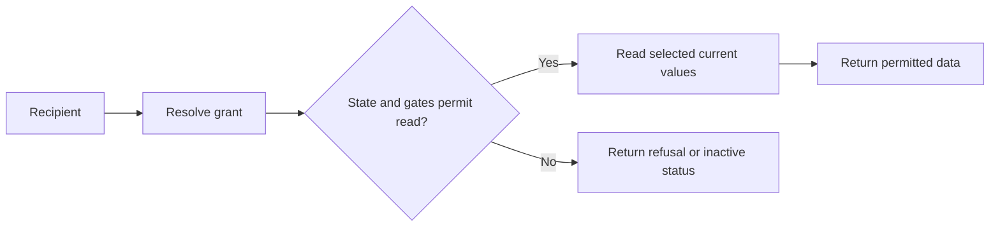
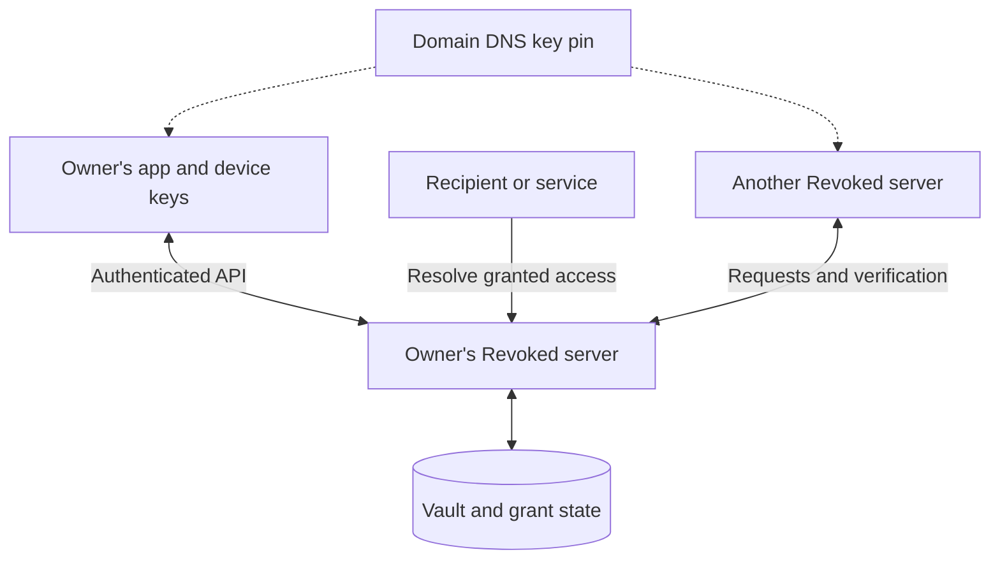

# Revoked: Living Grants for Owner-Controlled Data Exchange

**Review edition 0.6 · 12 November 2026**

This draft describes the model and documented architecture of an experimental implementation. It is not a security certification or a complete protocol specification. Implementation descriptions are grounded in the repository sources listed at the end. Proposed extensions and evaluation work are identified explicitly. Section 9.1 reports a limited local experiment; no production capacity or novelty claim is asserted. The initial code review baseline is commit `e831dd97134f4041570ae2a39e9ed2ee05010a19`; that working tree also contained unrelated app edits. The subsequent controlled in-flight experiment used commit `15b8183a5ad7ddffc25d236a816a0ac755d54690` plus its new test file, as recorded in Section 9.2. This revision combines targeted source inspection with the focused tests reported in Sections 9.1 and 9.2; it is not a complete implementation audit or full-suite validation.

**Project:** Revoked · **Document:** Technical white paper · **Status:** Author review

## Abstract

Applications commonly exchange personal and operational data by copying it. A recipient stores an address, credential, document, or configuration value and becomes responsible for its continued accuracy and retention. Changes at the source do not necessarily reach those copies, and withdrawing permission does not remove them. This creates a persistent mismatch between the person maintaining information and the systems that continue to use it.

Revoked explores an alternative organization of data exchange: a recipient holds a grant that resolves information from an owner-controlled vault. The owner can change the underlying information, pause access, or revoke the grant. Sharing and responding to a request use the same conceptual primitive, called a living grant. Independently operated servers provide storage and enforcement, while domain-anchored identities support verification across servers. Sign-in, selectively disclosed attestations, and scoped service connections extend this model to application integration.

The central guarantee is bounded. Revocation can prevent subsequent authorized retrieval through the system; it cannot remove information already observed or retained by a recipient. Availability, caching, operator trust, and key management therefore remain fundamental concerns. This paper presents the architecture, separates its trust mechanisms, and examines the engineering questions involved in making owner-controlled access practical. End-to-end encryption is discussed as an experimental, partially implemented extension with unresolved security and usability questions.

## 1. Motivation

An address entered into an online shop becomes a row in that shop's database. The same address may also exist in a payroll system, a membership directory, and a delivery service. Each copy has a different update mechanism and retention lifecycle. Moving house changes the underlying fact once, but correcting its representations becomes a series of separate administrative tasks.

The same pattern occurs with operational information. A contractor receives a password, a supplier receives bank details, or an organization collects a document. The transfer solves the immediate communication problem while creating another place where the information can become stale or remain accessible after its purpose ends.

Revoked starts from the observation that many recipients need access to information at a particular moment, rather than an indefinitely maintained local representation. An application can retain a reference and resolve the current value when it is needed. This moves responsibility for maintaining that value toward its source and makes continued retrieval conditional on an active grant.

Consider a shop that receives permission to read a delivery address. The customer can correct the address before fulfillment, and the shop can resolve the grant when preparing the shipment. Once the relationship ends, the customer can withdraw further access. A shipment already dispatched still has a historical destination, and any address retained by the shop remains beyond the grant's control. The application must distinguish current profile information from transaction history.

This distinction defines the scope of the proposal. Owner-controlled access can reduce unnecessary duplication and stale reads. It does not eliminate legitimate snapshots, compel recipients to discard data, or replace their own retention policies.

## 2. The living-grant model

### 2.1 Participants and objects

The model has four central elements:

| Element | Responsibility |
|---|---|
| Owner | Maintains information and controls grants issued over it. |
| Vault | Stores the records that form the source of shared values. |
| Grant | Defines access to selected records, subject to lifecycle state and applicable gates. |
| Recipient | Resolves a grant when information is needed. |

A record is a unit of stored information. Sections organize records, while workspaces provide an administrative context. A grant associates access with selected information and applicable conditions, such as expiration, a password, a view limit, or a verified recipient. Public links act as bearer capabilities unless additional checks restrict their use: possession of the link is itself authority to attempt access.

The defining property of a living grant is indirection. Its useful result is determined at resolution time from the current source records and the current access decision. Updating a record can therefore change what an existing grant returns without issuing another link. [1, 2]

### 2.2 Resolution and lifecycle

Conceptually, resolution performs two tasks: deciding whether a read is permitted and obtaining the values that read is allowed to expose. A valid reference alone is insufficient when the resolver observes that the grant is paused, revoked, expired, or subject to an unsatisfied gate. Section 2.5 specifies the boundary for concurrent changes and cached responses.



Pause provides a temporary interruption. Revocation withdraws the grant. Expiration bounds its lifetime, and a view limit bounds permitted retrievals according to the endpoint's counting semantics. These controls govern future resolution; they do not retract previous responses.

Concurrent requests complicate seemingly simple limits. If two readers both observe one remaining view before either increments a counter, a separate check and update can admit both. The repository specifies a guarded atomic update for claiming a view. This illustrates a broader requirement: security decisions that consume a finite allowance must be enforced at the same consistency boundary as consumption. [3]

“Current value” is also a limited claim. It means the source value selected by a successful resolution. It does not establish that a recipient still holds the latest value after the response, that several independently updated records form one business transaction, or that every exported representation remains synchronized.

### 2.3 Collection as a grant in the opposite direction

A request states what information another party needs. An answer backed by the responder's vault establishes access to the responder's information. The responder retains an account and a manageable grant, allowing later updates or withdrawal. Across servers, the authoritative answer remains with the responder's infrastructure, while the requesting server may temporarily cache a resolved value according to the origin's freshness hint. [1, 10]

This ownership requirement matters. A submitted snapshot without a manageable source may be useful as a form response, but it lacks the lifecycle properties of a living grant. The protocol and interface must make these cases distinguishable wherever both are supported.

### 2.4 Worked example: an address through its lifecycle

Ada maintains a delivery address on `ada.example`. A shop at `shop.example` uses Revoked sign-in and requests optional access to that address. The following sequence is illustrative, not a measured experiment. It uses an ordinary, unsealed address because the current sign-in grant path does not expose sealed values. The shop's cache policy is an explicit integration choice; it is not imposed automatically on arbitrary services by Revoked.

| Location | State retained in this example |
|---|---|
| Ada's vault | The authoritative address record and the grant's lifecycle state. |
| Shop account | The service-specific sign-in identifier and the grant ID/token needed for later resolution. The token is a credential and must be protected. |
| Shop's optional cache | A previously resolved address, its validator, and its freshness deadline. |
| Shipment record | A deliberate snapshot of the address actually used for that shipment. This is separate from the customer's current profile. |

**Approval.** Ada approves sign-in and selects the address. The shop creates its own session and retains the resulting grant reference. Refusing the address grant would still allow authentication; it would leave the shop to collect a delivery destination through another explicit interaction. [5]

**Initial read.** At illustrative time `t = 0`, the shop resolves the grant and receives address A, an ETag, and `maxAge: 60`. If it adopts that freshness policy, it can temporarily reuse A. The built-in federation reader implements such reuse in memory; an independently implemented shop must implement and document its own behavior. [10]

**Correction.** At `t = 10`, Ada changes the vault record to address B. A new authoritative resolution that observes the committed update returns B. A shop reusing its still-fresh cached response can continue showing A. Updating the source therefore does not establish instantaneous propagation to every consuming application.

**Fulfillment.** At `t = 20`, the shop prepares a shipment. In this example, its chosen fulfillment policy bypasses its local cache and resolves the grant again. After receiving B, it records B as the destination for that shipment. This is a proposed application policy, not a built-in guarantee that all consumers resolve before consequential actions. A concurrent address change still requires an application-level confirmation or version agreement if exact ordering matters.

**Withdrawal.** At `t = 25`, Ada revokes the grant. A later origin request that loads the committed revoked state returns no address values. A response whose authorization check happened earlier can still arrive later. The shop also still possesses its shipment record and may possess an unexpired cached response; withdrawal does not erase either.

**Outage.** If the origin becomes unavailable, the built-in federation reader may continue returning an unexpired cached value. Once that value expires, unsuccessful revalidation produces an unreachable result without the stale address. This example shop adopts the same rule and defers a new shipment until an address can be confirmed. Another consumer's behavior must be established by its own integration contract. [10]

```mermaid
sequenceDiagram
    participant A as Ada
    participant V as Ada's Revoked server
    participant S as Shop
    A->>V: Approve address grant
    S->>V: Resolve grant
    V-->>S: Address A, ETag, freshness hint
    A->>V: Update address to B
    Note over S: Cached A may remain usable under its cache policy
    S->>V: Resolve again before fulfillment
    V-->>S: Address B
    Note over S: Record shipment destination B
    A->>V: Revoke grant
    S->>V: New resolution observes revoked state
    V-->>S: Revoked; no address values
    Note over S: Earlier responses and shipment snapshot remain
```

The example separates four events that are easily conflated: changing the source, observing the change, withdrawing future access, and deleting an existing copy. Revoked directly supplies mechanisms for the first three, subject to the read path and trust assumptions. Deleting the shop's retained copy remains an action for the shop.

### 2.5 Guarantee boundaries

The table below describes the inspected behavior and its assumptions. “Origin” means the server holding the authoritative grant. A “fresh origin read” means a request that actually evaluates origin state; refreshing a screen or reading a local cache does not necessarily do so.

| Property | Supported statement | Boundary or unresolved question |
|---|---|---|
| Source updates | Resolution reads the selected source records rather than substituting an old response snapshot when a record is missing. | Remote caches may return an earlier value. A multi-record resolution is not established here as one atomic snapshot. |
| Revocation | A fresh origin read that loads revoked state is refused or returns no values through the inspected resolution paths. | A read that already passed its state check can finish after revocation. No global ordering guarantee has been established. |
| Cache freshness | The built-in federation reader reuses an entry until its local deadline and then revalidates. The default origin hint is 60 seconds; zero disables retention in this cache. | This is a cooperative cache policy, not a limit on recipient retention or an end-to-end revocation SLA. Events may invalidate entries earlier. |
| Origin failure | After cache expiry, failed remote revalidation yields an unreachable result without stale values. | Before expiry, the cache can answer without observing the failure or a recent revocation. |
| View limits | The public resolver claims a view with a guarded database increment before supplying data. | Atomic counter consumption does not make state checks, value reads, revocation, and delivery one atomic operation. Other endpoints need their own counting analysis. |
| Ordinary-value confidentiality | Access checks restrict callers at an honest server. | The operator can read unsealed values. |
| Sealed-value confidentiality | The design keeps plaintext and address keys outside normal server storage and resolves encrypted entries as ciphertext. | Trusted clients and key handling are assumed. Malicious delivered browser code, compromised devices, and retained keys remain outside this protection. Independent cryptographic review is outstanding. |
| Encrypted-link key replacement | The implemented transaction replaces the current wraps and seals together; the old address key does not open the replacement state. | A recipient or dishonest server can retain older ciphertext and key material. Key replacement is not retroactive erasure. |
| Authentication independence | The service creates and manages its own session; optional data grants have a separate lifecycle. | Revoking the address grant does not automatically sign Ada out of the shop. |

The code supports a specific concurrency qualification. In the public resolver, loading grant state and calling `RefreshLinkStatus` occur before the view claim and value serialization. `ClaimLinkView` guards the remaining view allowance, but its SQL predicate does not recheck lifecycle status. In the bulk grant path, `ResolveGrant` also checks a loaded grant and subsequently reads its records. Neither inspected path establishes a transaction spanning a concurrent revocation through response delivery. A schedule in which a reader observes active state, a writer commits revocation, and the reader subsequently returns data must therefore remain allowed by this paper's stated contract until a stronger ordering property is implemented and tested. Section 9.2 experimentally reproduces this schedule at the production grant-resolution service boundary. [10, 11, 14]

For caching, let `t_cache` be the local timestamp used to establish a cache entry and `delta` the accepted freshness hint. The built-in reader may reuse that entry while its local time is earlier than `t_cache + delta`, unless an event invalidates it. This describes cache reuse only. It does not bound how long a response already in flight may take to arrive, how long a consumer keeps plaintext, or when an application next chooses to read. The paper consequently makes no unconditional claim of “revocation everywhere within 60 seconds.”

These boundaries imply two distinct evaluation targets: whether requests observing withdrawn state disclose values, and whether requests overlapping withdrawal follow a defined ordering rule. The first is a basic enforcement property. The second requires controlled concurrency experiments and a stated decision about the intended protocol semantics.

## 3. Architecture and deployment

Revoked combines a Flutter client with a Go server built on PocketBase and an embedded SQLite database. The server exposes APIs for vault management, grant resolution, identity verification, and integrations. An operator can host an instance under its own domain. Other servers participate through network protocols rather than a shared database. [1, 2]



The architecture separates device-held identity keys from server-held data and access state. This separation should not be interpreted as universal confidentiality from the operator. Ordinary, unsealed values remain within the server's trust boundary. Sealed records introduce a different confidentiality model, described in Section 7.

The backend uses a dependency direction from startup and composition through routes and hooks to shared services and utility code. This organization supports reuse of lifecycle and enforcement logic across HTTP handlers and storage hooks. It also creates a review obligation: a lower-level write that bypasses request hooks must perform the authorization and audit work that the bypassed path would otherwise provide. [2, 3]

A single process and embedded database reduce deployment dependencies. They also constrain how the system can be replicated. The repository identifies process-local challenge state, download tokens, identity-status caching, and rate limiting. Multiple server processes would require explicit shared-state or coordination designs for these mechanisms; placing replicas behind a load balancer alone would not preserve their semantics. [3]

Self-hosting relocates operational responsibility. Backups, domain control, key custody, software updates, and availability become part of the operator's role. A restoration procedure must consider security history as well as data recovery: restoring older grant or identity state can reintroduce permissions that were withdrawn after the backup.

## 4. Trust across independently operated servers

### 4.1 Domain-anchored identity

Revoked's documented trust chain begins with a DNS TXT record under `_revoked.<domain>` that pins the domain's root-key fingerprint. A verifier obtains the server's public information, checks that the key matches the pin, verifies the identity's root signature, and checks whether the issuer still recognizes the identity. [4]

These checks answer different questions. A matching pin connects a key to the domain through the DNS lookup trust path. An identity signature connects an identity to that key. A challenge signature demonstrates possession of the corresponding private key. A status assertion reports whether the issuer continues to stand behind the identity.

Possession alone is insufficient. A former member may still hold a private key after an organization withdraws its endorsement. Revocation therefore needs an issuer-status mechanism as well as signature verification. The documented implementation retains revocation tombstones so that deleting an identity row does not erase its withdrawn status. [3, 4]

Domain anchoring does not eliminate infrastructure trust. DNS administration, the resolver path, transport security, and key distribution remain relevant. The final protocol analysis must document these assumptions explicitly, including key rotation and domain compromise. A domain signature also does not establish that a real-world statement is true or that its issuer is an acceptable authority.

### 4.2 Failure states

A verification result should preserve the distinction between a valid identity, an explicitly revoked identity, a signature or pin mismatch, and a check that could not be completed. A timeout does not prove revocation, and an unavailable status service does not justify a positive verification result.

The application still needs a policy for uncertain results. A low-risk public interaction may tolerate an unverified identity with a clear indication, while a sensitive operation may require successful verification. Cryptographic evidence supplies inputs to that policy; it cannot choose the appropriate business risk.

### 4.3 Signed-message context

Signatures must bind both the content and its intended meaning. The repository requires typed envelopes for root-signed status statements. Without context separation, a signature issued for one purpose might be accepted as authorization for another. This is an example of a protocol invariant whose importance exceeds the choice of cryptographic primitive. [3]

## 5. Authentication, data access, and attestations

### 5.1 Sign-in and continuing access

The sign-in integration uses an OpenID Connect authorization-code flow with PKCE. The inspected discovery route advertises pairwise subjects and `S256`, and authorization validation requires `S256`. OpenID Connect defines the identity layer; PKCE binds code redemption to the client-held verifier to mitigate intercepted authorization codes. See [OpenID Connect Core](https://openid.net/specs/openid-connect-core-1_0.html) and [RFC 7636](https://www.rfc-editor.org/rfc/rfc7636.html). A service receives a verified identifier and creates its own session. Data sharing is optional and separately approved: signing in must remain possible without granting access to an address or other vault information. [5]

Separating authentication from data access gives grants an independent lifecycle. A customer can withdraw an address grant without making an earlier sign-in cease to have happened. Likewise, a service session is managed by the service; ending a Revoked data grant should not be described as automatically terminating every downstream session.

The inspected `PairwiseSubject` function derives an identifier using HMAC-SHA256 over client, user, workspace, and an optional version. This establishes the implementation's derivation, not a complete OIDC conformance result. Service-specific identifiers can reduce reliance on a single identifier shared across applications. Their privacy benefit remains bounded by other disclosed information: two services that receive the same email address or other identifying data may still correlate their users.

### 5.2 Attestations and selective disclosure

An attestation is a statement an issuer makes about a holder. The documented credential design uses selectively disclosed claims and binds presentation to the holder's key. A verifier checks the issuer, the credential, the selected disclosures, the presentation binding, and relevant status information. [6] The underlying selective-disclosure and key-binding mechanisms are specified in [RFC 9901](https://www.rfc-editor.org/rfc/rfc9901.html); that RFC alone does not establish conformance to a particular verifiable-credential profile.

For example, an issuer can attest that a person meets an age threshold. The holder can present that claim without presenting every other claim in the credential. This benefit depends on the issuer actually supplying the needed predicate. Selecting claims is not an arbitrary proof system that derives new predicates from an undisclosed birth date.

A valid credential establishes who made the statement and whether the presentation checks succeed. The relying service must still decide which issuers it accepts for that statement. Credential status, identity status, issuer policy, and data-grant status are related but distinct forms of authority and must not be collapsed into a single ambiguous “trusted” flag.

## 6. Delegation to services and AI tools

An integration credential needs answers to two questions: what actions are permitted, and which data those actions may affect. Revoked's access design separates permissions from reach. Reach can exclude vault access, limit it to sections, or, for specially constrained connections, include the whole vault. [7]

A service can maintain records in its own section while receiving access to additional records only through an explicit grant of reach. The documented implementation tracks which credential wrote a record and limits modification accordingly. A record the owner exposes to a service does not automatically become a record that service may overwrite.

This separation is particularly useful for AI-assisted workflows. Proposing a share, reading a value, creating a share directly, and widening its audience are different capabilities. Consent should identify the capabilities actually granted and the data they cover. A general statement that an assistant is “connected” conveys too little.

Reach must be checked at the point of use. If access is inferred only when a token is issued, later removal of a record from an authorized section may fail to withdraw access. The repository therefore requires vault access by keys and connected tools to pass through a route family that evaluates reach on each request. [3, 7]

Disconnecting a service ends its continuing authority while preserving the owner's control over records it produced. This supports continuity when replacing integrations. It does not erase material the service previously retrieved.

## 7. Confidentiality and end-to-end encryption

### 7.1 Two trust models

For ordinary records, the server can read the values it stores and returns. Transport protection and server authorization do not change that fact. A curious or compromised operator is therefore a different adversary from an unauthorized external caller.

The current code includes sealed records and encrypted share links, including registered sealed-link routes and public responses containing ciphertext and wrapped value keys. Current user documentation also describes workspace access and browser decryption. This supersedes the older phase-one status at the top of `E2EE.md`. Files and aliases remain excluded in the current guide; request answers, sign-in grants, and tool vault reads do not decrypt sealed entries. Encryption remains alpha, with independent cryptographic review outstanding. [8, 11]

### 7.2 Key distribution and recovery

The design uses separate device wrapping and signing keys, workspace keys organized into epochs, and fresh value keys for individual versions. Workspace keys are distributed to authorized devices through a signed device-list mechanism. Recovery introduces another authorized way to recover key material rather than relying on an account password already visible to the server. [8]

The hard problem is authorization over time. A device must determine which other devices remain authorized, whether a list is newer than previously observed state, and whether a purported recovery operation is legitimate. Encryption of stored bytes does not by itself answer any of these questions.

The historical design records review findings that must be reconciled with subsequent changes rather than treated as a current vulnerability inventory. The current guide still identifies delayed device-list updates, first-contact trust, malicious browser code, and fresh-device downgrade risks. These documented limits constrain claims against an actively malicious server. Targeted source inspection does not replace an independent cryptographic review. [8, 11]

### 7.3 Encrypted living grants in the current implementation

An encrypted share carries a 32-byte address key in its URL fragment. The public resolver returns a sealed value and a viewer wrap, without a plaintext value. The client derives a record-specific copy key, opens the viewer wrap to recover the value key, and decrypts the record. A stale seal is reported as unavailable; an entry without a seal is omitted. These behaviors are documented in the current encrypted-link contract and reflected in the inspected public resolver. [11]

Updating a record renews its link seals. The sealed-link write path uses a transaction to associate current record versions with their seals. Key replacement requires the expected existing wraps and replaces the encrypted-entry seals together. An old address key then fails against the replacement state supplied by an honest server. Plain entries on a mixed link remain accessible under their own rules. [11]

This does not establish cryptographic erasure of older data. A recipient may retain ciphertext and keys, and a dishonest server may preserve old link state. Saved shares in the app maintain local version history to detect some replays; a fresh device has no such history, and browser readers do not retain equivalent history. Revocation and key replacement must therefore be described with an explicit server and client-state assumption. [11]

Browser delivery introduces another boundary. A URL fragment is ordinarily omitted from the HTTP request, but script executing in the page can read it. An adversarial server supplying the decryption page can alter that script to disclose keys or plaintext. The installed app avoids dependence on that particular page; its distribution and update path remain trusted. [11]

### 7.4 Metadata

Sealing values leaves other information visible in the documented design, including record labels, ownership, timestamps, section relationships, and grant structure. Metadata can reveal sensitive facts even when the value itself is encrypted. A precise privacy claim must specify which fields remain exposed and to whom.

## 8. Security and operational challenges

### 8.1 Recipient retention

The system can stop supplying information through a revoked grant. It cannot determine whether a recipient retained an earlier response, prevent a photograph of a displayed value, or control a copy transferred to another system. Watermarks and audit records may support attribution and accountability, but they do not change this information boundary.

### 8.2 Caching and revocation latency

Resolution-based enforcement provides an opportunity to check current grant state on every retrieval. A recipient that reuses cached plaintext is performing a different operation. Integrations must therefore define cache lifetime, revalidation, stale reads, and the behavior of exports.

In the inspected implementation, `GRANT_MAX_AGE` defaults to 60 seconds; zero disables retention in the built-in remote-grant cache. `ResolveRemoteGrants` reuses an unexpired in-memory entry without contacting its origin, then revalidates with an application-level ETag. If revalidation fails after expiry, it returns an unreachable result without stale values. Consequently, “revocation takes effect on the next read” needs qualification: a read served from this cache need not contact the authority. [10]

The JSON `maxAge` and `etag` fields are application protocol fields, not by themselves HTTP cache headers. HTTP freshness and validation are specified separately by [RFC 9111](https://www.rfc-editor.org/rfc/rfc9111.html). This distinction matters when documenting intermediate proxies and integrations.

A cache time-to-live can bound ordinary reuse by a cooperative client if that client honors the policy. It cannot bound retention by an adversarial recipient. Even for cooperative clients, any stated revocation latency must account for in-flight reads, status caches, clock assumptions, and failure behavior.

### 8.3 Availability and historical data

Resolving information at its source makes that source an operational dependency. If the owner's server is unavailable when a shop prepares a shipment, the shop needs an explicit response: defer fulfillment, request another source, or use a previously authorized snapshot under a declared policy.

Historical facts need their own representation. The address used for a shipment is an event-specific record; the customer's current delivery address is mutable profile data. Treating both as one changing reference would damage transaction history. Integrations must identify where a living grant ends and an intentional snapshot begins.

### 8.4 Outbound requests and tenant isolation

Federation and callbacks make servers initiate network requests. Attacker-controlled destinations can expose internal services unless address validation, connection-time checks, and redirect policy are enforced consistently. The repository specifies a shared safe outbound client for these paths. [3]

Within an instance, record identifiers do not establish authority. Access depends on workspace context, ownership or audience, permissions, credential reach, and the specific operation. Low-level storage paths and public resolution paths need the same scrutiny as ordinary authenticated collection APIs.

### 8.5 Logs, recovery, and visibility

An audit log can become a second secret store if it preserves old and new values without redaction. The repository explicitly excludes sensitive values and credentials from audit snapshots. Error messages likewise need to avoid exposing server-held identifiers or data to an unauthorized caller. [3]

Recovery procedures must preserve distinctions between an unknown identity and an explicitly withdrawn one. Workspace visibility introduces a further distinction between what a member can discover, what a member can edit, and what a public capability reveals. The current implementation contains `CanSee` and `CanEdit`, which require workspace membership and evaluate computed audience access, plus materialized reader/editor lists. The visibility design includes an extensive “As built” section; its introductory historical state is not an accurate inventory of current capabilities. This inspection establishes those mechanisms, not exhaustive coverage of every route. [9, 12]

## 9. Evaluation and limitations

The architecture motivates testable questions. The initial local observations in Section 9.1 cover a subset of this agenda. A reproducible evaluation should identify the exact source revision, configuration, hardware, dataset, network conditions, and client behavior used.

| Question | Experiment | Evidence to report |
|---|---|---|
| How expensive is grant resolution? | Compare local and cross-server reads over representative record sets and concurrency levels. | Throughput, latency percentiles, error rate, CPU and memory use. |
| When does revocation take effect? | Reproduce the address scenario in Section 2.4 with caching disabled and with a 60-second hint; hold an origin read after its state check while committing revocation. | State-check time, revocation commit, response completion, cache deadline, returned value/status, and whether a late response came from a cache or an overlapping read. |
| Are view limits enforced under contention? | Issue more simultaneous reads than the remaining allowance. | Successful claims, final counter, response consistency. |
| Does delegation remain scoped? | Exercise permitted and forbidden operations across owners, sections, and credential types. | An authorization matrix with observed results. |
| How does failure affect federation? | Interrupt peers, status endpoints, and DNS resolution. | Timeouts, verification verdicts, retries, and user-visible outcomes. |
| What survives restoration? | Restore a backup predating revocations and key changes in an isolated environment. | Reintroduced state, detection behavior, and recovery requirements. |
| Can sealed state withstand hostile delivery? | Replay and fork device lists, conceal removal, and present old record versions. | Accepted and rejected transitions, independently reviewed security arguments. |
| Do users understand authority? | Observe grant creation, pause, revocation, and tool consent tasks. | Task completion, mistaken expectations, and comprehension of retained copies. |

Performance results alone would not validate the security model. Correctness tests, adversarial protocol review, and usability evidence answer different questions and should be reported separately.

### 9.1 Initial local experiment

On 12 November 2026, five selected top-level tests passed against the baseline code plus the new [experiment tests](tests/whitepaper_test.go). The [reproduction guide](tools/whitepaper/README.md) and [captured result summary](tools/whitepaper/results/2026-11-12.txt) record the procedure and observations. The run used Go 1.27.4-X:nodwarf5 on Linux 7.3.3-1-cachyos, amd64, with 16 logical CPUs available. Client and server shared the host; no CPU or memory quota was applied. The existing test harness disables public rate limiters.

| Experiment | Observed result | Interpretation |
|---|---|---|
| Controlled origin changes A to B while cache holds A | Fresh cache returned A without an origin request; a pre-aged expired entry triggered a request returning B. | The built-in reader honors its freshness window. Cache expiry was injected, not measured by waiting 60 seconds. |
| Controlled origin reports revocation | Cached B remained readable; after explicit cache invalidation, resolution returned revoked with no values. | Cached reads and authoritative reads have distinct revocation behavior. This does not measure event delivery latency. |
| Controlled origin returns HTTP 503 after expiry | Resolution reported unreachable without cached values. | This failure path did not fall back to stale plaintext. |
| Freshness hint zero | Reader contacted the origin rather than reusing the seeded entry. | Zero disabled retention for this cache path. |
| Real loopback grant integration | Existing update, revocation, and token-bound read tests passed. | The result supplements the controlled-origin cache experiment with actual route and persistence behavior. |
| Real public link, one allowed view, 32 concurrent readers | One successful response, 31 non-success responses, no transport or server errors. | The view cap held in this single concurrent burst. |

For the concurrent burst, response latency was 38.832 ms at p50, 41.939 ms at p95, and 41.945 ms maximum. These nearest-rank observations include all 32 responses, predominantly refusals. They are not successful-grant latency percentiles or a throughput benchmark. One burst cannot characterize performance variability or establish correctness under every scheduling order.

The selected test process completed in 1.626 seconds. Cache tests use an HTTP-controlled origin and pre-aged entries to isolate behavior without sleep-based expiry tests; they do not represent two independently deployed Revoked servers. Existing federation tests route peer traffic over loopback to a single test instance. This initial run did not include a controlled pause between authorization and revocation commit; Section 9.2 reports that follow-up separately. Network-distance measurements and sustained-load measurements remain unperformed.

### 9.2 Controlled read overlapping revocation

A follow-up experiment ran `TestWhitepaperInFlightRevocation` three times on baseline `15b8183a5ad7ddffc25d236a816a0ac755d54690`, with the new [experiment file](tests/whitepaper_inflight_test.go). All three executions passed. The [captured outcomes](tools/whitepaper/results/2026-11-12-inflight.txt) record the ordered observations; total test-process time was 1.491 seconds, including fixture setup. This time is not a revocation-latency measurement.

The experiment creates a genuine request response through the loopback HTTP fixture and loads the resulting active grant. It invokes the production `ResolveGrant` service with a test-only application wrapper that pauses its first granted-record lookup. That lookup occurs after the service's lifecycle check. The wrapper delegates database operations to the real application and changes no production implementation.

With the resolver paused, the experiment revokes the grant through the authenticated collection API, waits for the successful HTTP response, and reloads the grant to confirm persisted revoked state. It then releases the reader. In every execution, the overlapping read returned `active` and the granted email value. Resolving the freshly loaded revoked grant returned `revoked` with no values.

The channel barrier establishes ordering without relying on a lucky scheduler or an arbitrary sleep. The assertion intentionally records existing behavior: a request authorized against an earlier record can finish after withdrawal. If the implementation later rechecks state or introduces stronger serialization, this characterization test and the paper must be revised together rather than preserving the old behavior as a product requirement.

This is a service-boundary experiment with HTTP-backed setup and revocation. It does not intercept a complete `/api/grants/resolve` HTTP request, exercise every public-share or download path, establish a bound on network delivery, or estimate how frequently the interleaving occurs naturally. Its supported conclusion is narrower: the production `ResolveGrant` operation can return a value after an overlapping revocation has committed when it already passed its lifecycle check. A fresh read that observes the revoked state remains denied.

## 10. Related work and positioning

Revoked belongs to an existing family of designs that separate an application from the authority governing its data. The comparisons below concern architecture and protocol purpose, rather than measured superiority.

| Reference | Established mechanism | Relationship to Revoked |
|---|---|---|
| [Solid Protocol](https://solidproject.org/TR/protocol) | Independently hosted data resources accessed by applications through a common protocol. | Both separate storage from consuming applications. Revoked organizes its interface around vault records, shares, and responder-managed grants. No Solid interoperability is claimed. |
| [OAuth bearer tokens, RFC 6750](https://www.rfc-editor.org/rfc/rfc6750.html) | Possession of a bearer token permits access without separate proof of a cryptographic key. | Revoked links have a related possession-based authority boundary when additional gates are absent. This is a conceptual comparison; a share slug is not thereby an OAuth access token. |
| [OpenID Connect Core](https://openid.net/specs/openid-connect-core-1_0.html) | Authentication and identity claims, including pairwise subject identifiers. | Revoked uses this integration model while keeping continuing data grants distinct from a relying service's session. |
| [SD-JWT, RFC 9901](https://www.rfc-editor.org/rfc/rfc9901.html) | Selective disclosure of signed claims and optional holder key binding. | Revoked builds its attestation workflow on this mechanism and adds its domain-key discovery and status conventions. |

Solid is a particularly relevant comparison because personal data storage and application independence are central to its protocol. The cited Solid Protocol 0.11.0 is a Draft Community Group Report, not a W3C Standard. Its common resource protocol and Revoked's grant-oriented workflow occupy overlapping design space, but a detailed interoperability or feature-equivalence assessment has not been performed.

These antecedents mean the individual mechanisms should not be presented as inventions of Revoked. The contribution explored here is their integration into one workflow: maintain records, answer requests through owner-controlled grants, establish issuer identity, and delegate bounded service access. A useful next comparison would implement the same address-update and withdrawal scenario in another personal-data system, measuring integration effort and observable semantics under failures. No novelty or superiority conclusion follows from the present descriptive comparison.

## 11. Conclusion

Revoked treats data exchange as a continuing relationship whose permissions can change after the first interaction. A living grant keeps a recipient connected to an owner-maintained source and makes future retrieval conditional on continuing authorization. The model applies to direct sharing, collected responses, and service integrations while keeping authentication and attestation as distinct mechanisms.

The practical value depends on honest boundaries. Recipients can retain what they have seen. Current-data access requires available infrastructure. Caching changes freshness. Encryption introduces device membership, recovery, and state-consistency problems that server-side permission checks do not solve.

The initial experiments substantiate a limited set of behaviors: cooperative cache reuse and expiry, refusal after an observed revocation, a one-view allowance under a concurrent burst, and completion of a service read that overlaps withdrawal. These results support an experimental architecture account, not a comprehensive security or performance assessment. Applications must still decide where continuing access is appropriate and where intentional historical snapshots are necessary.

## References and evidence scope

The sources below are local, evolving project documents rather than immutable publication references. Some combine historical descriptions with later changes. The baseline revision is pinned above. The code evidence below supports selected claims; uninspected paths and full protocol conformance remain outside this review.

1. [Project overview](README.md) and [How it works](docs/how-it-works/index.md): product model, sharing, collection, and federation.
2. [Architecture overview](ARCHITECTURE.md): topology, data model, backend organization, and implementation context. Used for architectural context; current behavioral claims are qualified by the code evidence below.
3. [Repository invariants](CLAUDE.md): security invariants, atomic view claims, revocation tombstones, outbound-request protections, audit redaction, and process-local state.
4. [Trust-chain documentation](docs/api/trust-chain.md): DNS anchoring, signatures, identity status, and verification outcomes.
5. [Sign-in documentation](docs/api/sign-in.md): authentication flow, PKCE, service sessions, and optional data grants.
6. [Attestation documentation](docs/api/attestations.md): credential claims, selective disclosure, holder binding, and revocation.
7. [Access design](ACCESS.md), especially “As built”: permissions, credential reach, provenance, and integration constraints.
8. [Encryption design](E2EE.md), including its status and review findings: sealed records, proposed extensions, threat model, and known limitations.
9. [Visibility design](VISIBILITY.md): audience and editing proposals and the access-model problems motivating them.

10. [Grant resolution](cmd/revoked/services/grants.go) and [remote grant caching](cmd/revoked/services/remoteGrants.go): source status checks, token validation, default freshness, conditional reads, and unavailable-origin behavior.
11. [Current encryption guide](docs/guide/encryption.md), [encrypted-link contract](docs/api/encrypted-links.md), [sealed-link writes](cmd/revoked/routes/sealedLinks.go), [route registration](cmd/revoked/routes/sealed.go), and [public resolution](cmd/revoked/routes/publicLinks.go): current sharing behavior and documented security limits.
12. [Visibility implementation](cmd/revoked/services/visibility.go): membership checks and computed/materialized access lists.
13. [OIDC routes](cmd/revoked/routes/oidc.go) and [subject derivation](util/oidc.go): advertised flows, PKCE requirements, and pairwise-subject construction.
14. [View claiming](cmd/revoked/services/links.go): guarded counter increment. The counter operation alone does not establish atomic ordering between every concurrent lifecycle update and read.

External sources are linked at the claims they support and were consulted on 12 November 2026. Standards references describe the mechanisms, not certification of this implementation.

**Scope of this review edition:** experimental architecture and limited local observations. Comprehensive endpoint coverage, production capacity, standards conformance, and independent cryptographic validation remain outside the evidence presented. The publication makes no claims in those areas.
