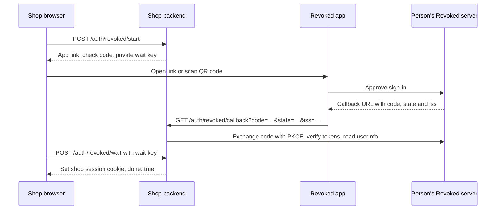

# Sign in with Revoked

Sign in with Revoked lets a service authenticate people through their Revoked
app. The service receives a verified account identifier and creates its own
session. No Revoked password, client secret or advance client registration is
required.

For example, a shop can sign Ada in and ask for a delivery address. Ada approves
in the Revoked app and chooses whether to share that address. The shop receives
an account identifier and, if approved, a grant for reading the current address.
Signing in and sharing data are separate: the shop must still work when Ada
shares no address.

## Working example

The repository includes **Corner Shop**, a complete Node.js service using
`openid-client`. It includes the button, callback, session handling and grant
reads. Requirements: Node 22 or later, and the [Revoked app](../installation/app.md)
signed in to a server on the same computer.

From the repository root:

```bash
cd examples/sign-in-demo
npm install
cp .env.example .env
npm start
```

At <http://localhost:4000>, **Sign in with Revoked** opens a panel with a QR code,
an app link and a check code. Opening the app link, comparing the codes and
approving signs the waiting browser in. No vault entries are required. If an
address is shared, it appears on the shop's account page.

For sign-in without any data request, the same demo runs with:

```bash
REQUESTED_KEYS= npm start
```

A phone cannot reach a callback at `localhost` on a computer. For a QR sign-in
from a phone, `PUBLIC_URL` must be an origin the phone can reach, such as
`https://shop.example.com`. The demo's [README](https://github.com/argseby/revoked/tree/main/examples/sign-in-demo)
covers its settings. The [sign-in lab](../labs/sign-in.md) also demonstrates
editing and revoking a shared address.

## The four participants

| Participant | Example | Responsibility |
|---|---|---|
| Service page | Shop in a desktop browser | Displays the button and waits for completion. |
| Service backend | `https://shop.example.com` | Prepares the request, verifies the answer and creates a shop session. |
| Revoked app | Ada's phone or desktop app | Shows the request and obtains approval. |
| Revoked server | `https://id.example.com` | Issues the authorization code, tokens and any data grants. |

The service backend and Revoked server are different systems. The person's app
already knows their Revoked server, so the shop does not need to ask for it
before showing the button.



Polling starts when the panel opens and continues while approval is pending.
The callback can come from a phone; the session belongs to the browser holding
the private wait key.

## Client settings

Revoked implements OpenID Connect (OIDC), using the authorization code flow
with PKCE. PKCE binds a one-time authorization code to a secret verifier held
by the service backend.

| Setting | Example | Meaning |
|---|---|---|
| Client ID | `https://shop.example.com` | The service's origin, without a path. |
| Redirect URI | `https://shop.example.com/auth/revoked/callback` | A callback on that same origin. |
| Client secret | None | Public client; PKCE with `S256` is required. |
| Scopes | `openid profile` | `openid` is required; profile data is optional. |
| Issuer | `https://id.example.com` | The person's Revoked server, learned from `iss` in the callback. |
| Discovery | `https://id.example.com/.well-known/openid-configuration` | Metadata used by the OIDC library. |

Local development also supports `http://localhost:<port>`. Production origins
use HTTPS. The full endpoint contract is in the
[OpenID Connect reference](reference/openid-connect.md).

## Add it to your service

The following route names are examples. Corner Shop calls them `/login/start`,
`/callback` and `/login/wait`; the behavior is the same.

### 1. Button

Copy `revoked-sign-in.js` from
[`examples/sign-in-button`](https://github.com/argseby/revoked/tree/main/examples/sign-in-button)
to the service's static files, served here as `/revoked/revoked-sign-in.js`:

```html
<script type="module" src="/revoked/revoked-sign-in.js"></script>
<revoked-sign-in
  start="/auth/revoked/start"
  wait="/auth/revoked/wait"
  done="/account"
  label="signin">
</revoked-sign-in>
```

On success, the browser navigates to `/account`. Without `done`, it reloads the
current page. The component supplies the panel, QR code, check code and polling;
`start` and `wait` are routes implemented by the service, not Revoked endpoints.
A Content-Security-Policy needs `script-src 'self'` and `connect-src 'self'`.
The [button README](https://github.com/argseby/revoked/tree/main/examples/sign-in-button#attributes)
lists appearance and language options.

### 2. Start route

`POST /auth/revoked/start` creates a PKCE verifier and challenge, random `state`,
random `nonce`, and a separate random `wait` key. The service stores the verifier,
state and nonce with the wait key for ten minutes. These values have different
jobs:

| Value | Travels to | Purpose |
|---|---|---|
| PKCE verifier | Token endpoint, during code exchange only | Proves the service exchanging the code started the request. |
| PKCE challenge | App link | Public SHA-256 challenge derived from the verifier. |
| `state` | App link and callback | Finds the pending request and checks the answer belongs to it. |
| `nonce` | App link, then checked against the ID token | Binds the ID token to this request. |
| `wait` | Starting browser only | Lets that browser collect the result and receive a session. |

The button sends a JSON request with body `{}`. A successful response looks like
this; the shortened values are illustrative:

```json
{
  "app_link": "revoked://signin?client_id=https%3A%2F%2Fshop.example.com&redirect_uri=https%3A%2F%2Fshop.example.com%2Fauth%2Frevoked%2Fcallback&response_type=code&scope=openid%20profile&state=STATE&nonce=NONCE&code_challenge=CHALLENGE&code_challenge_method=S256&revoked_return=background",
  "check_code": "0D2-99B",
  "wait": "PRIVATE_RANDOM_WAIT_KEY"
}
```

The link is built with `URLSearchParams`, so every parameter is URL-encoded.
`revoked_return=background` asks the app to deliver the callback directly,
allowing the waiting browser to be on another device. The `wait` key never goes
in the app link or QR code.

This Node.js excerpt builds the link and check code. It runs on the backend;
the service still needs to store `pending`, generate the private wait key and
return the response above:

```js
import { createHash } from 'node:crypto';
import * as oidc from 'openid-client';

const pending = {
  verifier: oidc.randomPKCECodeVerifier(),
  state: oidc.randomState(),
  nonce: oidc.randomNonce(),
};
const challenge = await oidc.calculatePKCECodeChallenge(pending.verifier);
const params = new URLSearchParams({
  client_id: 'https://shop.example.com',
  redirect_uri: 'https://shop.example.com/auth/revoked/callback',
  response_type: 'code',
  scope: 'openid profile',
  state: pending.state,
  nonce: pending.nonce,
  code_challenge: challenge,
  code_challenge_method: 'S256',
  revoked_return: 'background',
});
const appLink = `revoked://signin?${params}`;
const hex = createHash('sha256').update(challenge).digest('hex')
  .slice(0, 6).toUpperCase();
const checkCode = `${hex.slice(0, 3)}-${hex.slice(3)}`;
```

The check code is derived from the challenge's text, not the verifier. The app
computes it independently, so both screens display the same value.

### 3. Callback route

After approval, the app requests the service's callback:

```http
GET /auth/revoked/callback?code=ONE_TIME_CODE&state=STATE&iss=https%3A%2F%2Fid.example.com
```

The backend finds and consumes the pending request by `state`. Unknown, expired
or already used states cannot complete a sign-in. A declined request instead
carries `error=access_denied`; that result is stored for the waiting browser.

For a successful answer, the backend validates the issuer **before fetching
it**, discovers its OIDC metadata, exchanges the code using the saved verifier,
and verifies the tokens with its OIDC library. The saved state and nonce must
also be checked. [Issuer validation](#finding-the-persons-server) explains this
step. The demo implements it in
[`auth.js`](https://github.com/argseby/revoked/blob/main/examples/sign-in-demo/src/auth.js).

For a service accepting one explicitly configured issuer, the exchange can
look like this. `oidc` is the `openid-client` import from the start example;
`pending` is loaded from server-side storage, and `callbackUrl` is a `URL`
constructed from the configured callback address and received query parameters:

```js
async function exchangeCode(pending, callbackUrl) {
  const issuer = callbackUrl.searchParams.get('iss');
  if (issuer !== 'https://id.example.com') {
    throw new Error('Issuer is not allowed');
  }
  const provider = await oidc.discovery(
    new URL(issuer), 'https://shop.example.com',
    undefined, oidc.None(),
  );
  const tokens = await oidc.authorizationCodeGrant(provider, callbackUrl, {
    pkceCodeVerifier: pending.verifier,
    expectedState: pending.state,
    expectedNonce: pending.nonce,
    idTokenExpected: true,
  });
  const claims = tokens.claims();
  const userinfo = await oidc.fetchUserInfo(
    provider, tokens.access_token, claims.sub,
  );
  return { issuer, subject: claims.sub, userinfo };
}
```

This excerpt covers token verification, not the route's storage, error handling
or session creation. A service accepting multiple issuers applies its issuer
policy before discovery; it must not simply remove the check above.

After verification, a typical application result is:

```json
{
  "issuer": "https://id.example.com",
  "subject": "service_specific_subject",
  "name": "Ada"
}
```

`issuer` and `subject` together identify the local account. `name` is optional
and can change. This is application data assembled from verified tokens and
userinfo, not a token response to trust directly from the callback query.

The result is stored for the wait route. The callback returns a status below
400; the app does not follow redirects. No service session is created on this
response, and no browser cookie is required: the request may come from a phone.

### 4. Wait route and service session

The button polls `POST /auth/revoked/wait` with:

```json
{ "wait": "PRIVATE_RANDOM_WAIT_KEY" }
```

While approval or token verification is pending:

```json
{ "done": false }
```

Once verification succeeds, the backend creates its own session and sets its
session cookie **on this wait response**:

```http
HTTP/1.1 200 OK
Content-Type: application/json
Cache-Control: no-store
Set-Cookie: shop_session=RANDOM_SESSION_ID; HttpOnly; Secure; SameSite=Lax; Path=/

{"done":true}
```

A declined request returns `{ "done": true, "error": "access_denied" }` without
creating a session. An expired or already collected wait key returns `401`.
The completed result is collected once. Responses containing pending sign-in
data or session credentials use `Cache-Control: no-store`.

[`server.js`](https://github.com/argseby/revoked/blob/main/examples/sign-in-demo/src/server.js)
and [`signins.js`](https://github.com/argseby/revoked/blob/main/examples/sign-in-demo/src/signins.js)
provide the complete route and storage implementations.

### Native apps

The Flutter package
[`packages/revoked_sign_in`](https://github.com/argseby/revoked/tree/main/packages/revoked_sign_in)
uses the same routes and draws a native button and panel. It adds
`"client": "app"` to the wait request because it has no browser cookie jar:

```json
{ "wait": "PRIVATE_RANDOM_WAIT_KEY", "client": "app" }
```

A service supporting native apps returns its own app session token in the body,
for example `{ "done": true, "session": "…", "expires_in": 28800 }`. The
package passes that answer to the application. This session token belongs to
the service; it is separate from Revoked's OIDC access token.

### Deployment requirements

- Pending requests and results need a shared store when the service has more
  than one backend instance. Each callback and completed result is consumed
  atomically once.
- Session IDs are fresh after sign-in. Production browser cookies use
  `HttpOnly`, `Secure` and an appropriate `SameSite` policy.
- Issuers are restricted to trusted origins, or fetched through a client that
  blocks private/internal destinations and rechecks DNS results at connection
  time. HTTPS alone does not make an arbitrary issuer safe to fetch.
- Grant tokens remain on the backend. The grant endpoint must belong to the
  verified issuer before credentials are sent to it.

## Approving in the app

A sign-in is approved in the person's Revoked app and nowhere else. There is
no passkey prompt and no consent screen in the browser: the authorization
endpoint only hands the request to the app.

The app shows who is asking, as which account, and what the service would
learn. An approval asks for the person's fingerprint, face or device PIN —
Face ID or Touch ID on Apple devices, the biometric prompt on Android,
Windows Hello on Windows — and the app signs it with an identity key that
never leaves the device. Linux has no such prompt; there the identity key is
the only proof. A session token on its own, or a copied link opened
elsewhere, approves nothing.

Once the person decides, the app hands the service the redirect address with
the code, the state, and `iss` — the issuer of the server that answered
(RFC 9207). With `revoked_return=background` it requests that address itself.
Without it, it opens the address in the system browser, which then has to be
the browser the sign-in started in. That is why a service's button should
always use the former.

## Finding the person's server

Which server a person uses is not known in advance, since every instance is
self-hosted. The person's Revoked app knows it, so a sign-in starts there.

### Through the app

A "Sign in with Revoked" button carries the authorization request itself as a
`revoked://signin` link, which depends on nothing about the server. The app
opens the request on the server it is signed into, and the person approves it
there, in the app.

The service then works as with a known server, starting from `iss`:

1. `iss` is checked like any server the service accepts: an `https` origin,
   on an allow-list if the service keeps one.
2. Discovery runs against `iss`. Client libraries refuse metadata whose
   `issuer` differs, and refuse an answer whose `iss` differs from the
   discovered issuer.
3. The code is redeemed at that server's token endpoint, with the PKCE
   verifier and the `state` and `nonce` the service remembered.

A person is known by the issuer and `sub` together. An answer from a server
other than the person's own cannot sign anyone in as one of that server's
users: the code, the ID token and the subject all belong to the server that
issued them.

### Approving someone else's sign-in

A service that waits hands the session to the browser that holds the pending
sign-in, so a sign-in can be approved on a device other than the one that ends
up signed in. As with any QR sign-in, someone could show a person their own
code and ask them to approve it. The app names the service and the check code,
and asks the person to approve only what they just started themselves. The
page shows the same code, so the person can compare the two.

If the app cannot reach the service, it opens the redirect address in the
browser instead. The service records the answer as usual, so the waiting page
carries on.

### Through the authorization endpoint

A client library that sends the browser to a known server's
`authorization_endpoint` reaches a page that opens the app with the same
request, as a `revoked://signin` link. The app answers on the server it is
signed into; a service that expects a particular issuer compares `iss` with
it. This only works when the app is on the same device, and the answer comes
back through that device's default browser. Use the button above unless your
library leaves you no choice.

### Without the app

Signing in needs the Revoked app, though not on the device the person is
browsing with: the QR code covers that case. On a device without the app,
`revoked://` leads nowhere. Most browsers stay on the page, and some show an
error, so the panel says the app is needed.

## Scopes and claims

| Scope | Claims |
|---|---|
| `openid` (required) | `sub` |
| `profile` | `name` |
| `email` | `email`, `email_verified` |
| `revoked_identity` | `revoked_identity` — the fingerprint of the person's primary identity, the same at every service |

`email_verified` means that the issuing server reports that the person
confirmed access to that email address. It does not make the address a
globally trusted identity: any self-hosted server can issue claims for its
own users, and a service must decide which issuers it trusts before relying
on an email address for account lookup, recovery or authorization. A service
that accepts arbitrary Revoked issuers should use `(iss, sub)` to identify an
account, not the email address. Email confirmation proves mailbox access at
the time of confirmation; it does not establish a person's legal identity or
continued control of the address.

`name` is the name the person chose for this service: one of their identities'
names, or a vault entry. A person can give each service a different name, or
none, in which case `profile` is left out of the granted scopes. There is no
account-wide name. Use `sub` to recognise someone, because a name can change.

When the name comes from a vault entry, the userinfo response also carries a
grant with the key `name` (see [Asking for vault entries](#asking-for-vault-entries)).
Read it to follow the current name without another sign-in. Revoking that grant
stops the `name` claim too. The ID token and userinfo always answer with the
name as it stands, but a plain OIDC client that reads them only at sign-in sees
a change at the next sign-in.

`sub` is different at every service: the same person signing in to two
services gives each its own identifier, so services cannot match their users
with each other. Each of the person's workspaces is a separate account as well:
signing in from another workspace gives the service another `sub`, and no name
or entry chosen in the first workspace is offered. `sub` stays the same for one
service and workspace across sign-ins, unless the person asks for a new one
([Pausing and disconnecting](#pausing-and-disconnecting)).

The person can decline every scope but `openid` in the app. The
`scope` returned by the token endpoint lists what was granted.

## Asking for vault entries

Entries from the person's vault are asked for by key, through the `claims`
parameter:

```json
{ "userinfo": { "revoked_links": { "values": ["shipping_address", "phone"] } } }
```

In the start-route example, this object is serialized into the authorization
request before building `appLink`:

```js
params.set('claims', JSON.stringify({
  userinfo: {
    revoked_links: { values: ['shipping_address', 'phone'] },
  },
}));
```

`openid profile` alone does not request these vault keys. The `claims` parameter
adds them; the person can still decline both. When no entries are shared,
userinfo may contain only `sub` and any other approved claims, with no
`revoked_links`. That is a successful sign-in with no data grant.

In the app the person picks one of the entries in their active workspace for
each key, types a new value, or shares nothing. A new value is saved as an entry
under that key, or the next free key if it is taken. Picking an entry with
another key adds an alias under the key asked for, unless the key is taken or
the entry is a file. The person can switch workspace from the consent screen,
which opens the request again with a new ticket. An entry from any other
workspace is refused with `oidc_link_record_invalid`. Switching workspace also
switches the account the service sees, so each workspace shares through its own
link. New values and aliases are filed in a
section keyed `signin_<host>` and get the service's host in `requestedBy`;
entries the person already had are not moved. The userinfo endpoint then returns a grant
over the chosen entries:

```json
{
  "sub": "4kS0…",
  "revoked_links": {
    "endpoint": "https://<domain>/api/grants/resolve",
    "grants": [ { "id": "q8w2…", "token": "…", "keys": ["shipping_address"] } ]
  }
}
```

The values are read from `endpoint` with the grant's id and token, whenever
they are needed:

```
POST /api/grants/resolve
{ "grants": [ { "id": "q8w2…", "token": "…" } ] }
```

For example, a backend read uses the endpoint and credentials from userinfo:

```bash
curl --fail-with-body 'https://id.example.com/api/grants/resolve' \
  -H 'Content-Type: application/json' \
  -d '{"grants":[{"id":"GRANT_ID","token":"GRANT_TOKEN"}]}'
```

`GRANT_ID` and `GRANT_TOKEN` are placeholders for the returned grant. No
workspace API key or OIDC bearer header is needed; the grant token in the body
authorizes this read. A successful response can look like this:

```json
{
  "items": [{
    "id": "GRANT_ID",
    "status": "active",
    "values": { "shipping_address": "Musterstraße 12, Berlin" },
    "etag": "\"0123456789abcdef0123456789abcdef\"",
    "maxAge": 60
  }]
}
```

`maxAge` is supplied by the server; `60` is an example, not a constant to hardcode.
A later read can send the returned `etag` inside the grant object. An unchanged
answer has `notModified: true` and omits `values`, so the previous values can be
reused within the new cache period. A non-active status stops those values
being displayed. A failed read does not extend their permitted cache period.

Each answer carries the current values, an `etag` for asking again cheaply,
and `maxAge`, the number of seconds a value may be kept before it is read
again. When the person edits the entry, the next read returns the new value;
when they revoke the grant, the next read returns `revoked` and no values.

The grant appears in the person's app as a link of their own, labelled with
the service's origin. Signing in again and sharing again updates that same
link and replaces its token.

Every approval also leaves a row in the person's `signIns` collection: the
service's origin, the scopes it has learned, its link if it has one, where its
name comes from, and when the person last signed in. The app lists these under **Settings → Connected
tools**. The row can't be written through the collection API and holds no
values, and each approval is written to the audit log as `sign_in_approved`.

## Sessions

Every sign-in is approved in the person's app, and the provider keeps no
session of its own. Consequently:

- `prompt=none` is always answered with `login_required`.
- There are no refresh tokens. The ID token proves a sign-in that just
  happened; the service keeps its own session after that.
- There is nothing to log out of at the provider.

## Pausing and disconnecting

The person can stop a service at any time. None of this reaches the session your
service keeps for itself, so a person stays signed in with you until you end it.

| | Pause | Disconnect | Disconnect with a new ID |
|---|---|---|---|
| Sign-in requests | Answered `access_denied`, exactly as if declined | Asked again, in the app | Asked again, in the app |
| Access tokens and unredeemed codes | Refused while paused, good again after | Refused for good | Refused for good |
| Grants | `paused`, no values | `revoked` | `revoked` |
| `sub` on return | The same | The same | A new one |

The endpoints are `POST /api/sign-ins/{id}/pause`, `/resume` and `/disconnect`
with `{"newId": true}`, in the [reference](reference/openid-connect.md).

A new `sub` is unrelated to the old one, and the grant that comes with the next
share has a new id. Treat that sign-in like anyone else's first one: a new person
to you. Your old account for them stays yours to delete. Don't match them up by
email or name to bring the old account back. They asked to be someone new, and
they may decline to share either.

A paused service gets the same `access_denied` as a decline, so it can't tell a
pause from a no.

## Troubleshooting

| Symptom | Check |
|---|---|
| The button opens a panel but the app link does nothing. | The Revoked app must be installed and registered for `revoked://` links. A phone can scan the QR code instead. |
| Phone approval never completes the desktop sign-in. | The callback must be reachable from the phone. `localhost` refers to the phone itself. |
| Callback succeeds but the browser is still signed out. | The callback stores the result; the wait response must create the browser session. Check that the button polls the correct route and the cookie is accepted. |
| Wait returns `401`. | The wait key expired or its completed result was already collected. A new sign-in creates a new key. |
| Sign-in returns no name, email or address. | These are optional. The person may decline them. An `openid`-only approval is still a valid sign-in. |
| A revoked address disappears but the customer remains signed in. | Grant access and the shop's session are independent. The shop controls when its session ends. |
| Discovery rejects the issuer. | Compare callback `iss`, the allowed origin and discovery's `issuer` exactly, including scheme and port. |

## The signing key

ID tokens are signed with RS256 by a key published at `/oidc/jwks`. It is not
the server's root key but a separate key the root key certifies; the
certification is published with it as `revoked_certification`. A service that
walks the [trust chain](trust-chain.md) from the DNS pin to the root key can
check that certification and so tie every ID token to the domain. Ordinary
client libraries ignore the member and verify tokens against the JWKS as
usual.
