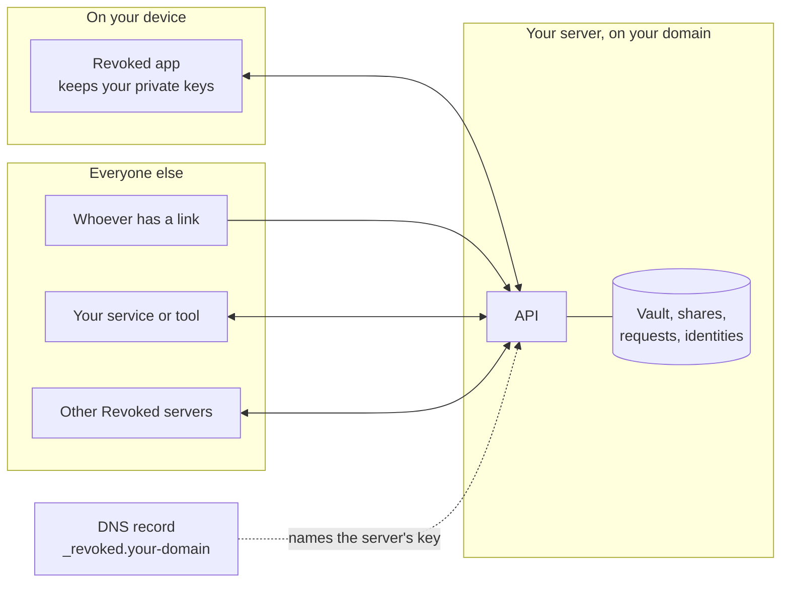
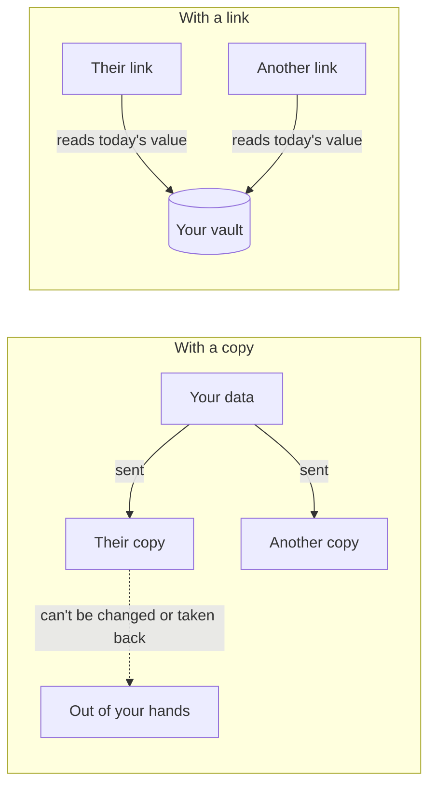
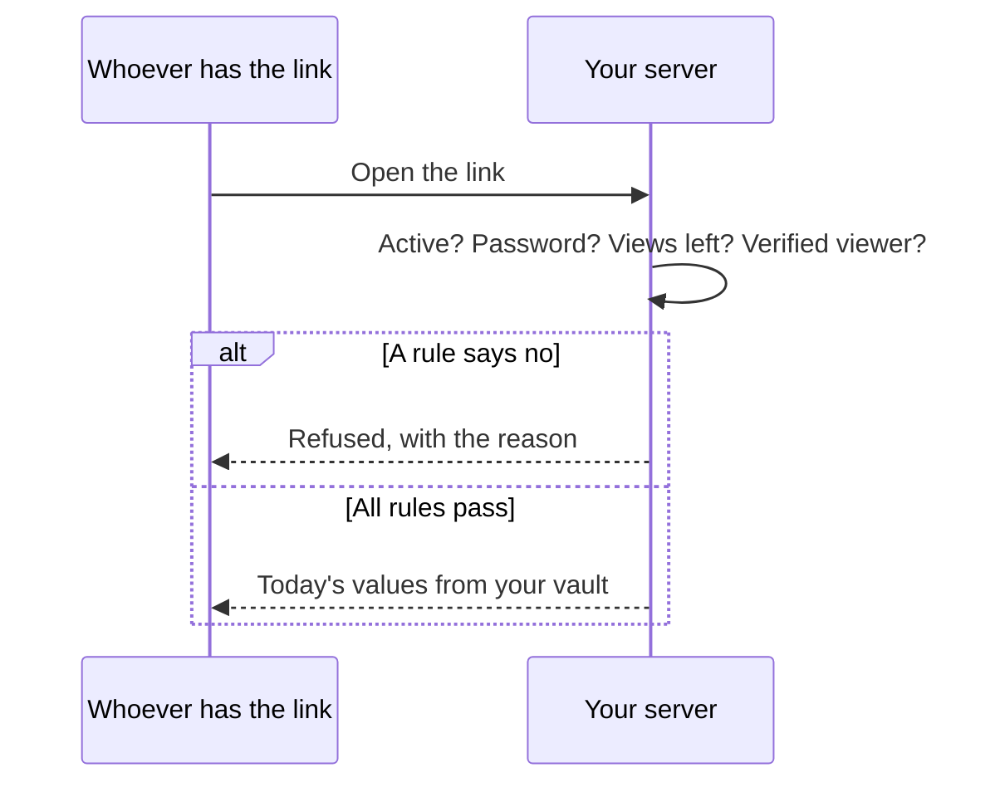
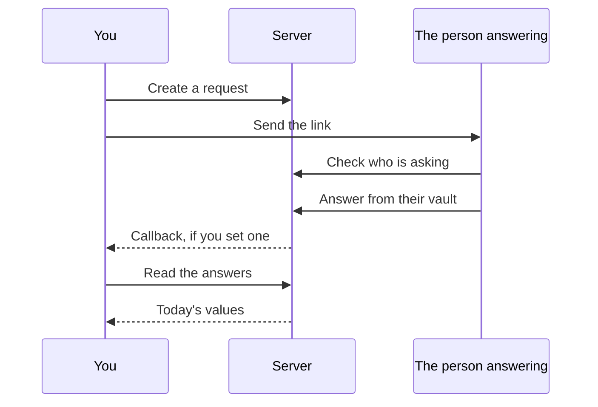
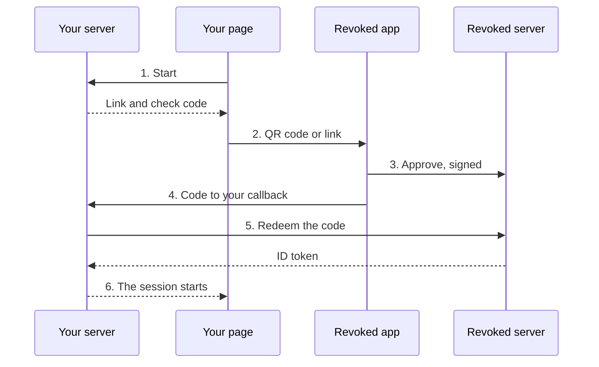
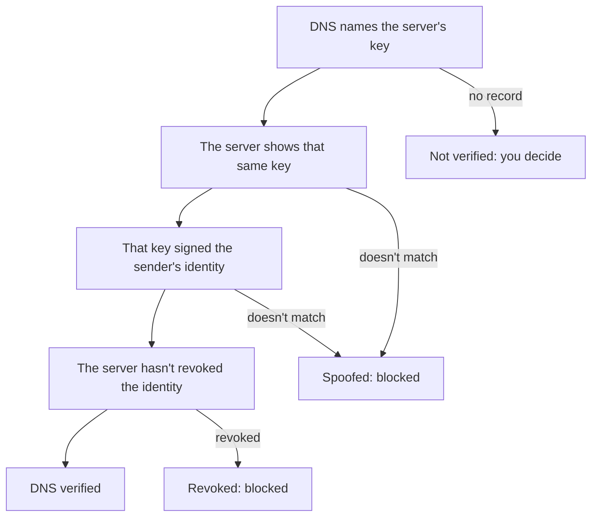
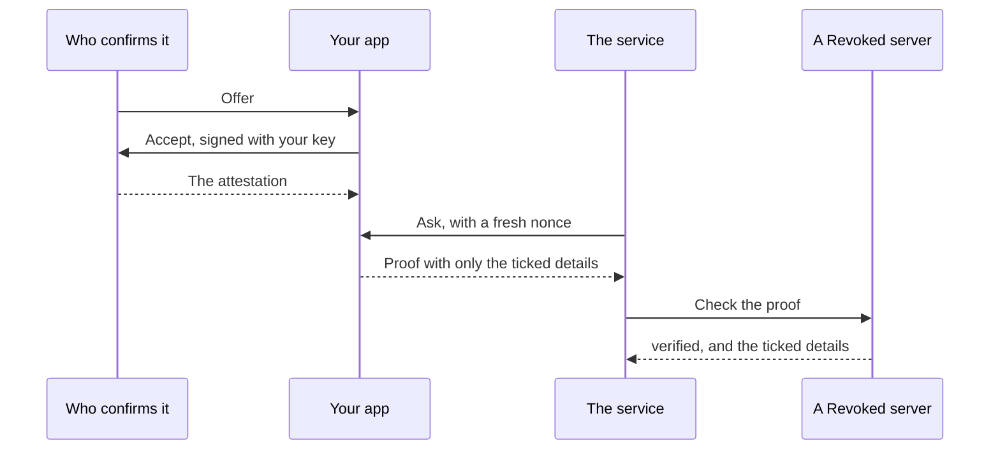
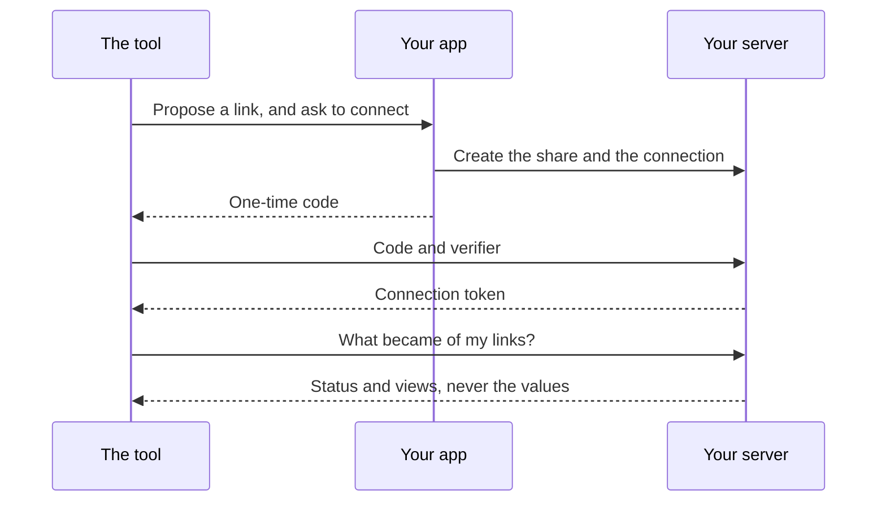

# How it works

Revoked is client and server infrastructure for exchanging data. Whoever holds
data shares it, and whoever needs data requests it. Either way, the data stays
with its owner, and everyone else gets access they can lose.

<video controls preload="none" playsinline poster="https://revoked.link/video/revoked-short-wide.jpg" style="width:100%" aria-label="A short film showing how to share a link, change a value, revoke access, ask for data and sign people in with Revoked. It has no sound.">
  <source media="(max-width: 599px)" src="https://revoked.link/video/revoked-short-tall.mp4" type="video/mp4">
  <source src="https://revoked.link/video/revoked-short-wide.mp4" type="video/mp4">
</video>

## The big picture

Every person uses the app, and every app talks to a server of their choosing.
Services and tools talk to that same server. Servers talk to each other, so people
on different servers can answer each other.

| Part | What it does |
|---|---|
| **App** | Your window on all of it. Your identity's private key is made here and never leaves the device. |
| **Server** | Keeps your vault, and checks the rules every time someone opens a link. One Go binary with a built-in database. |
| **DNS record** | Names your server's key, which is what ties it to your domain. |
| **API** | Everything the app does, this API does. There are no private endpoints. |

## Why it's access, not copies

A copy leaves your hands the moment you send it. A link goes back to the vault
every time, so each change and each revocation takes effect on the next read.

## Five ways to use it

Each one is the same idea with a different starting point.

| | Who starts it | What the other side ends up with | Try it |
|---|---|---|---|
| **Share** | Whoever has the data | A link to records | [Lab](../labs/share.md) |
| **Collect** | Whoever needs the data | A link to their answer, or the typed answer | [Lab](../labs/collect.md) |
| **Sign in** | A service | An ID made for it, and any entries you agreed to share | [Lab](../labs/sign-in.md) |
| **Prove** | A service, or whoever asks | Only the details you ticked, and proof they're real | [Lab](../labs/prove.md) |
| **Connect** | A tool | The status and views of links it proposed | [Lab](../labs/connect.md) |

## Share

## Collect

An answer is kept in the workspace of whoever gave it, so they can change it or
take it back. When people are on different servers, the answer stays at home, and
the other server fetches it each time it's needed.

## Sign in

Revoked keeps no session of its own. Every sign-in is approved in the app, and the
service keeps its own session after that.

## Prove

Every check starts from DNS. That's what stops anyone from claiming to be someone
they aren't.

## Connect

## What the server can and can't see

| | Server sees it? | Why |
|---|---|---|
| Your vault records | Yes | It reads them to answer a link. Run your own server, so it's yours. |
| An end-to-end encrypted record | **No** | Encrypted on your device. Its value on the server is always empty. |
| Your identity's private key | **No** | Made on your device, and it never leaves. |
| Your passkey | **No** | Your device keeps it. The server only sees the public half. |
| Who opened a link | How often | It counts views. The owner sees the count. |

## Go deeper

- [Trust chain](../api/trust-chain.md) explains each check, for developers.
- [Authentication](../api/authentication.md) covers the three credentials.
- [Roadmap](../roadmap.md) has what's planned and how it's designed.
