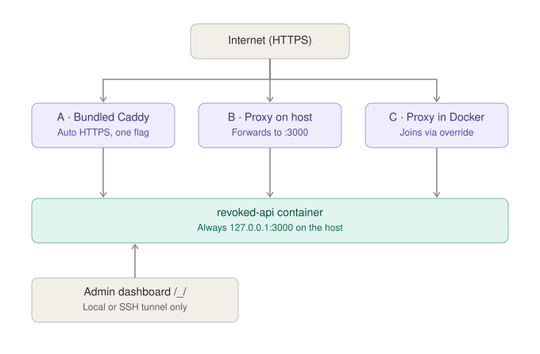

# Set up a server

The server is one Go binary with a built-in database. In production it runs in
a container behind a reverse proxy that terminates TLS, with one DNS record
that other servers check its identities against.

**Requirements:**

- A domain or subdomain that points at the machine, such as `api.example.com`.
  It becomes `DOMAIN`, and it is chosen once: every identity the server issues
  is signed for it, and other servers check those identities against DNS
  records under it.
- Docker with Compose.

A reverse proxy is optional up front: the stack brings one along.

## How traffic reaches the server



The container answers on `127.0.0.1:3000` of the host and on no other
address. Public HTTPS reaches it through one of three proxies, described in
[Reverse proxy](reverse-proxy.md):

| Path | Fits a host that | Command |
|---|---|---|
| **A · Bundled Caddy** | runs no proxy yet | `docker compose --profile caddy up -d` |
| **B · Proxy on the host** | runs nginx, Caddy or Apache directly | `docker compose up -d`, the proxy forwarding to `http://127.0.0.1:3000` |
| **C · Proxy in Docker** | runs Nginx Proxy Manager, Traefik or another proxy container | `docker compose -f docker-compose.yml -f docker-compose.network.yml up -d` |

The superuser dashboard at `/_/` and its sign-in answer only requests that
reach the container directly, never through a proxy. It is opened over an SSH
tunnel (see [Dashboard](reverse-proxy.md#dashboard)).

## Install

```bash
git clone https://github.com/argseby/revoked && cd revoked
cp .env.example .env                  # DOMAIN is the one required value
docker compose --profile caddy up -d  # path A; B and C as in the table above
docker compose logs api               # prints the DNS record to publish
```

No Docker network has to exist beforehand, and nothing is configured in the
dashboard: the proxy header that rate limits read is set from
`TRUSTED_PROXY_HEADER` at every start.

For a server reached at `https://api.example.com`, the relevant `.env` values
are:

```dotenv
DOMAIN=api.example.com
ALLOW_SIGNUPS=false
```

`DOMAIN` is a hostname, without `https://` or a path. With signups disabled,
accounts are added through the [account setup](accounts.md) rather than
through public registration.

Compose pulls the release image on every `up`, so nothing is built. A build of
this checkout goes through a second file, which tags the result
`revoked:local` rather than the release image's name:

```bash
docker compose -f docker-compose.yml -f docker-compose.build.yml up -d --build
```

## Checks before going public

The API answers on the machine itself:

```bash
curl http://127.0.0.1:3000/healthz
curl -fsS http://127.0.0.1:3000/api/server | jq -r .version
```

Published images carry their release version. A build from source reads it
from the checkout's Git tags, or from `REVOKED_VERSION` when the copy has no
Git metadata; without either it reports `dev`. A server that reports `dev`
while the stack names the published image is running a local build left
under that name, which the next `up` replaces, since the image is pulled
every time.

From another computer, an SSH tunnel brings the same address there, for the
app and for the dashboard alike:

```bash
ssh -L 3000:127.0.0.1:3000 admin@api.example.com
```

`API_PUBLISH=3000` publishes the port on every interface instead. `/healthz`
and the version then answer by the machine's IP, but signing in does not: a
passkey cannot be bound to an IP address. A port open by IP also skips the
proxy's TLS, so it is set back before the server goes public.

**Then, in this order:**

1. [Publish the `_revoked` TXT record](dns.md) the logs printed. It is what
   makes the server's identities checkable.
2. [Reverse proxy](reverse-proxy.md), unless path A already serves HTTPS.
3. [Add people](accounts.md). Nobody can sign up on their own unless signups
   are allowed.
4. [Back up `pb_data`](backups.md). It holds the one file that can never be
   recreated.

Every setting is in the [.env reference](env.md). Once the server runs, people
get [the app](app.md), or go straight to the desktop and Android downloads.

## Verification and common failures

| Check | Expected result | If it fails |
|---|---|---|
| `curl --fail-with-body http://127.0.0.1:3000/healthz` on the host | `ok` | `docker compose logs api`, the required `DOMAIN`, and the published port. |
| `curl --fail-with-body https://api.example.com/healthz` from another machine | `ok` over valid HTTPS | Public DNS, TLS, ports 80 and 443 for path A, and the proxy's upstream. |
| `curl -s -o /dev/null -w '%{http_code}' https://api.example.com/_/` | `404` | `DASHBOARD_ACCESS` is `public`, or the proxy sends no `X-Forwarded-For`. |
| `dig TXT _revoked.api.example.com +short` | The fingerprint printed by this server. | The exact TXT record name, and time for DNS propagation. |
| App sign-in against `https://api.example.com` | A passkey ceremony for that domain. | Account setup, and that the app uses the domain rather than a LAN IP address. |

A successful health check proves the process is reachable. It does not prove
that account setup or the identity trust chain is complete.

## Upgrade {#upgrade}

Every release publishes a new image. The app's settings show **Server update
available** once the server runs an older release than the newest one.

With `REVOKED_IMAGE` left at `:latest`, `docker compose up -d` pulls the
newest release, since the stack pulls its image on every `up`.

With a pinned release, the tag in `REVOKED_IMAGE` changes and
`docker compose up -d` pulls the new one on the way. `pb_data` carries over,
and migrations run when the server starts. [A backup](backups.md) comes
first.

## Portainer

A **git-backed** stack uses the compose path `docker-compose.yml`, with the
`.env` values in Portainer's *Environment variables* section.

- **Path A:** the variable `COMPOSE_PROFILES=caddy` starts the bundled Caddy.
- **Path B:** nothing beyond the compose path.
- **Path C:** `docker-compose.network.yml` goes under *Additional paths*, and
  `PROXY_NETWORK` names the proxy's network.

The stack runs the published image, `ghcr.io/argseby/revoked`, which carries
its release; Portainer builds nothing, and every redeploy pulls the image, so
`:latest` moves without *Re-pull image*. A release is pinned by setting
`REVOKED_IMAGE` to the full image reference, such as
`ghcr.io/argseby/revoked:v0.36.0`. A tag alone (`latest`, `:v0.36.0`) is not
an image name, and the pull fails with *pull access denied*. Left unset, the
stack runs `:latest`.
