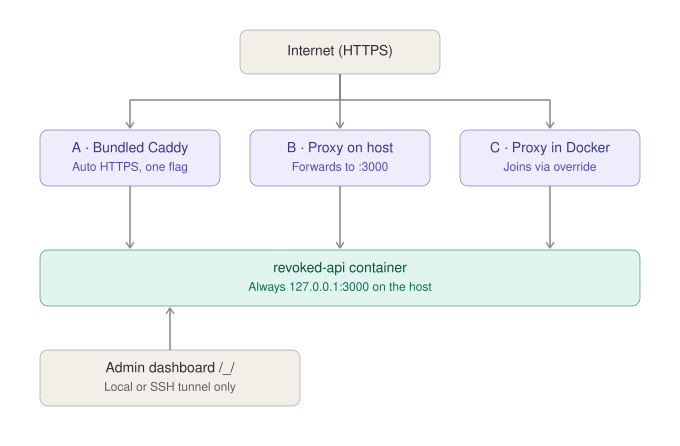

# Reverse proxy

The API does not terminate TLS itself. It answers on `127.0.0.1:3000` of the
host only, and public HTTPS reaches it through one reverse proxy, in one of
three ways.



## A · Bundled Caddy {#caddy}

For a host without a proxy of its own:

```bash
docker compose --profile caddy up -d
```

Caddy obtains and renews a Let's Encrypt certificate for `DOMAIN` on its own.
It needs `DOMAIN` to point at the machine and ports 80 and 443 to be reachable
from the internet; `HTTP_PORT` and `HTTPS_PORT` move them when something else
holds them. Certificates live in the `caddy_data` volume, so a restart does
not request new ones. The configuration is `deploy/caddy/Caddyfile`.

`SITE_ADDRESS=localhost` serves a local test instead, with a certificate from
Caddy's own authority, at `https://localhost`.

## B · Proxy on the host {#host}

A proxy that runs directly on the machine — nginx, Caddy, Apache — forwards to
`http://127.0.0.1:3000`. For nginx:

```nginx
location / {
    proxy_pass http://127.0.0.1:3000;
    proxy_http_version 1.1;
    proxy_set_header Host              $host;
    proxy_set_header X-Forwarded-For   $proxy_add_x_forwarded_for;
    proxy_set_header X-Forwarded-Proto $scheme;
    # The realtime channel is server-sent events, which buffering would hold.
    proxy_buffering off;
    proxy_read_timeout 1h;
    # At or above FILE_MAX_SIZE, so an oversized upload gets the API's error.
    client_max_body_size 2g;
    proxy_request_buffering off;
}
```

For Caddy, the whole site is `reverse_proxy 127.0.0.1:3000`.

## C · Proxy in Docker {#docker}

A proxy in its own container — Nginx Proxy Manager, Traefik — cannot reach the
host's `127.0.0.1`. It reaches the API by name over a Docker network it is
already on, which a second compose file joins:

```bash
docker compose -f docker-compose.yml -f docker-compose.network.yml up -d
```

`PROXY_NETWORK` names that network, `proxy-network` unless set. The proxy then
forwards to `http://revoked-api:3000` (`CONTAINER_NAME:API_PORT`). Plain HTTP
is fine there: the traffic never leaves the Docker network.

**Nginx Proxy Manager:** forward hostname `revoked-api`, forward port `3000`,
scheme `http`, with *Websockets support* on for the realtime channel.

## Client addresses

Rate limits key on the client's address, which the proxy passes in
`X-Forwarded-For`. The server trusts that header from its first start
(`TRUSTED_PROXY_HEADER`), reading the rightmost entry — the one the proxy
appended — so a client cannot claim another address. The bundled Caddy, nginx,
Traefik and Nginx Proxy Manager all set it.

One proxy sits in front, not two: each proxy in a row adds an entry, and
behind two every request seems to come from the outer one, so all per-IP
[rate limits](env.md#rate-limits) share one budget. A server reached with no
proxy at all sets `TRUSTED_PROXY_HEADER=none`, since any client could write
the header itself.

## Dashboard {#dashboard}

`/_/` is the superuser dashboard. It and the superuser sign-in behind it answer
only requests that reach the container directly — from the machine itself, or
over an SSH tunnel — and return `404` to anything that came through a proxy.
From another computer:

```bash
ssh -L 3000:127.0.0.1:3000 admin@api.example.com
```

The dashboard is then at `http://localhost:3000/_/`. `DASHBOARD_ACCESS=public`
serves it through the proxy as well; an access list on the proxy then limits
`/_/` to known addresses.

A request counts as direct when it carries no forwarding header and arrives
from a loopback or private address. A proxy that adds no `X-Forwarded-For`
would therefore look direct, which is one more reason the header is set.
