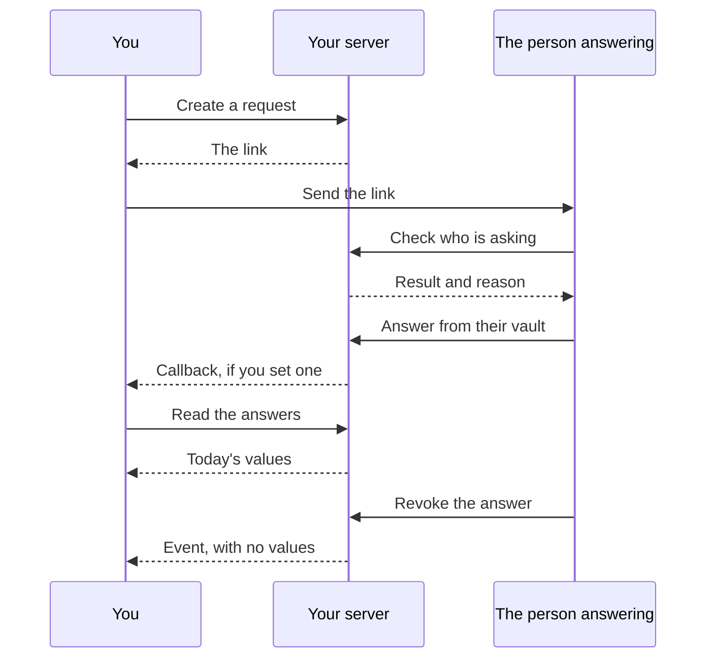

# Lab: Collect

Ask for information with a request, answer it, and watch the answer stay under
the control of whoever gave it. Then send answers to your own system. It takes
about 15 minutes.

**You need** the app, signed in. For the last part, you also need Python and a
way to reach your computer from the internet.

<video controls preload="none" playsinline poster="https://revoked.link/video/film-collect-wide.jpg" style="width:100%" aria-label="A short film showing how to ask for information with a request and read the answers. It has no sound.">
  <source media="(max-width: 599px)" src="https://revoked.link/video/film-collect-tall.mp4" type="video/mp4">
  <source src="https://revoked.link/video/film-collect-wide.mp4" type="video/mp4">
</video>

## 1. Ask for what you need

Choose **New → Request** and pick the built-in **Wi-Fi access** template, or any
other. Its fields are what people are asked to fill in. Choose
**Create request**.

**You should see** the link, and a short message to send with it. The link looks
like `revoked://r/api.revoked.link/…`.

## 2. Answer it

A real answer comes from someone else. To see the other side yourself, create a
second account with another email address, on a second device or in a second
copy of the app.

Open the link with **New → Open or scan a link**.

**You should see** the result of the check first: who is asking, and the reason.
Answering needs an account, because your answer is kept in your own workspace.

Without an account, the server refuses. You can try that:

```bash
curl -X POST "https://api.revoked.link/api/public/requests/<slug>" \
  -H "Content-Type: application/json" -d '{"data":{}}'
```

```json
{ "code": "request_account_required", "message": "An account on this server is required to respond to a request.", "status": 401 }
```

## 3. Answer from your vault

For one field, choose **Use a record** and pick a record from your vault. For
another, choose **Use a different value** and type something. Send it.

**You should see** your answer in your own workspace, as a link you can manage.

## 4. Read the answers

Back on the first account, open the request and press **View responses**. Switch
between **List** and **Sheet**.

**You should see** one row per person and one column per field. Each answer
shows whether it was typed or links to the person's vault.

## 5. Change the answer

On the second account, change the record you used in step 3. Then look at the
answers on the first account again.

**You should see** the new value. Nobody sent anything new. A typed answer can't
do this, which is why **Use a record** is the better choice.

## 6. Take it back

On the second account, press **Revoke response**.

**You should see**, on the first account, that the answer was revoked and no
longer shows its value.

## 7. Send answers to your own system

A **Callback URL** sends every answer to your system as it arrives. Start the
listener:

```bash
python3 examples/labs/listen.py 8000
```

The server has to be able to reach it, so choose one of these:

=== "Test server, with a tunnel"

    Use a tunnel such as [Cloudflare Tunnel](https://developers.cloudflare.com/cloudflare-one/connections/connect-networks/do-more-with-tunnels/trycloudflare/)
    to get a public address for your listener:

    ```bash
    cloudflared tunnel --url http://localhost:8000
    ```

    Use the address it prints, with `/hook` on the end, as your callback URL.

=== "Your own computer"

    Run a server on your own computer. This setting is what lets it call a
    local address:

    ```bash
    DOMAIN=localhost ALLOW_SIGNUPS=true ALLOW_PRIVATE_CALLBACKS=true \
      go run ./cmd/revoked serve --http=127.0.0.1:3000
    ```

    Use `http://127.0.0.1:8000/hook` as your callback URL.

    !!! danger "Never switch this on for a public server"
        `ALLOW_PRIVATE_CALLBACKS=true` lets anyone who can create a request make
        your server call into your private network. Use it only on a machine
        that's yours alone.

Make a new request. Under **Advanced → Limits and callback**, enter the callback
URL. Answer the request.

**You should see** the answer in your listener's window:

```text
POST /hook
X-Revoked-Request: lxt7nlkvfqairg5
{
  "requestId": "lxt7nlkvfqairg5",
  "slug": "vendor-onboarding",
  "responseId": "9k2m4pqx81zvwy3",
  "linkId": "9k2m4pqx81zvwy3",
  "identity": "wt27a6nyfx93u3w",
  "identifier": "",
  "senderName": "Ada Lovelace",
  "data": { "email": "ada@example.com" }
}
```

Revoke the answer again.

**You should see** a second delivery with `"event": "grant.revoked"`. An event
never carries a value, so your system learns what changed without receiving any
more data.

## What just happened

The answer stayed with the person who gave it. You hold a link to it.



## If something doesn't match

| What you see | What to do |
|---|---|
| `request_account_required` | Sign in. Answering needs an account. |
| `validation_callback_url_blocked` | The address is local or private. Use a tunnel, or your own computer. |
| Nothing reaches your listener | Check that the tunnel is running and the address ends in `/hook`. Deliveries aren't retried, so answer again. |
| The answer's value doesn't change | That field was typed. Only an answer from a record stays current. |

## Next

- [Requests](../guide/requests.md) has every option.
- [Callbacks](../api/callbacks.md) has the full delivery and event format.
- [Lab: Prove](prove.md) shows how to check who you're dealing with.
