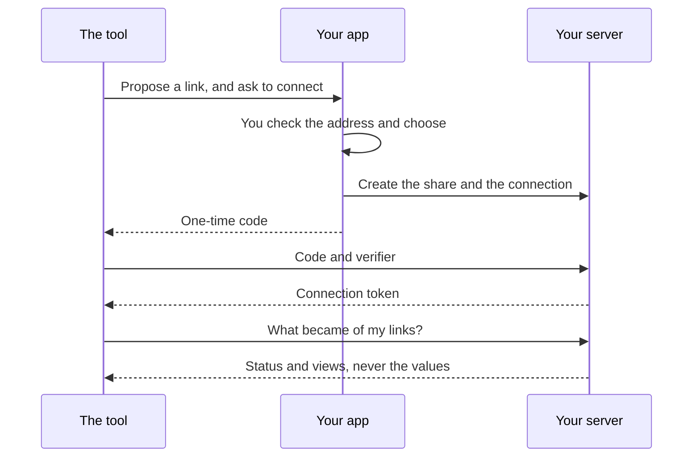

# Lab: Connect

Run a tiny tool, let it propose a link, and connect it. Then see what it can see
and what it can't. It takes about 15 minutes.

**You need** the app, signed in, on the same computer as the tool. You also need
Python.

<video controls preload="none" playsinline poster="https://revoked.link/video/film-connect-wide.jpg" style="width:100%" aria-label="A short film showing how a tool connects to your account, and what it can and can't see. It has no sound.">
  <source media="(max-width: 599px)" src="https://revoked.link/video/film-connect-tall.mp4" type="video/mp4">
  <source src="https://revoked.link/video/film-connect-wide.mp4" type="video/mp4">
</video>

## 1. Start the tool

Guestbook is one HTML file, with no backend and no account of its own.

```bash
cd examples/labs/guestbook
python3 -m http.server 8000
```

Open <http://localhost:8000>.

**You should see** one button: **Register for the summer party**.

## 2. Let it propose a link

Press the button. The page opens the app with a link proposal.

**You should see** **Link proposal from Guestbook**, with the tool's address
next to it. The name is only what the tool calls itself, so check the address.

The tool named three keys: `full_name`, `email` and `dietary_restrictions`. The
app finds them in your vault, and lets you fill in any that are missing. The tool
never saw any of this.

## 3. Connect it

The proposal also asks to connect.

**You should see** what the tool can do, what you decide, and what it can never
do. It can never read your vault, your other links or your account.

Tick **Receive the links it proposed**, leave **Revoke links it proposed**
unticked, and continue. Nothing is shared until you approve it.

## 4. See what it sees

The browser opens Guestbook again.

**You should see** your link in the list, with its status and how often it was
opened:

```text
Summer party (summer-2026): active, opened 0× https://api.revoked.link/s/k7Qx…
```

The address is there because you let the tool receive its links.

## 5. Watch it follow along

Open the link once, then reload Guestbook.

**You should see** `opened 1×`. Under **Shares** in the app, press **Pause**, and
reload again.

**You should see** `paused`. The tool knows what became of its link. It still
doesn't know what's in it.

## 6. Manage it

Open **Settings → Connected tools**.

**You should see** Guestbook, when you connected it, when the connection ends,
and its link. A connection lasts 90 days from the last time you confirmed it, and
a tool can't keep itself alive.

Press **Disconnect**, and reload Guestbook.

**You should see** an empty list. The tool is cut off at once, and its stored
token no longer works. In the app, the link is still there and still yours.

## What just happened

Guestbook held a token that opens only one thing: the status of the links it
proposed.



## If something doesn't match

| What you see | What to do |
|---|---|
| The button does nothing | The app isn't registered for `revoked://` links. See [Install the app](../installation/app.md). |
| The browser doesn't return to Guestbook | The app opens your default browser, which may not be the one you started in. Open <http://localhost:8000> there. |
| `connection_unauthorized` | The tool was disconnected. Connect it again. |
| `connection_expired` | 90 days have passed. Only you can connect it again, from the app. |
| `connection_paused` | You paused the tool. Press **Activate** in the app. |
| No link address in the list | Links with a hidden record or a file are never handed over. Copy those yourself. |

## Next

- [Tools & link proposals](../guide/tools.md) has the whole picture for people.
- [Building a tool](../api/tools.md) has the link format and every endpoint.
- [Lab: Sign in](sign-in.md) is the other way a service can work with Revoked.
