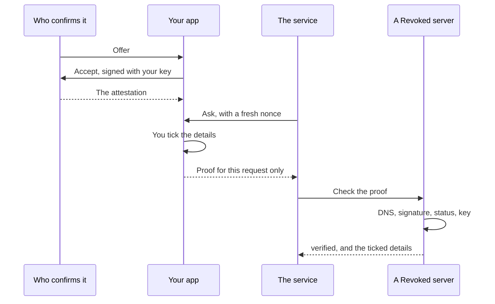

# Lab: Prove

Have a fact confirmed, keep it in your app, and show only part of it. Then check
it the way a service would. It takes about 15 minutes.

**You need** the app, signed in. For the last part, you also need Python.

<video controls preload="none" playsinline poster="https://revoked.link/video/film-prove-wide.jpg" style="width:100%" aria-label="A short film showing how the app checks who sent something, and how attestations work. It has no sound.">
  <source media="(max-width: 599px)" src="https://revoked.link/video/film-prove-tall.mp4" type="video/mp4">
  <source src="https://revoked.link/video/film-prove-wide.mp4" type="video/mp4">
</video>

## 1. Confirm something

An attestation is something someone else confirms about you. Here, you play both
parts.

Choose **New → Attestation** and fill in:

| Field | Enter |
|---|---|
| **Kind** | `lab_member` |
| Detail (yes/no) | `member`: yes |
| Detail (text) | `member_since`: `2026` |

Choose **Create offer**. Copy the link right away, because it's shown only once.

**You should see** the attestation under **Issued**, reading **Offered**.

## 2. Accept it

Open the link with **New → Open or scan a link**.

**You should see** who confirms it, what it confirms, and which identity gets
it. Press **Accept**. Your identity's key signs, and nothing else is sent.

**You should see** it under **Held**, with the status **Verified**.

## 3. Ask to see it

Now play the service. Choose **New → See someone's attestation**:

| Field | Enter |
|---|---|
| Kind | `lab_member` |
| Details you need | `member` |

Choose **Create check**, and copy the link. It works once, for ten minutes.

## 4. Show only part of it

Open the link.

**You should see** who is asking, and a tick box for each detail. `member` starts
ticked and `member_since` doesn't. Leave them that way, and press **Show it**.

The proof is made on your device and made for this one request. The service
can't pass it on.

## 5. See what the service sees

Open **Attestations → Checked**.

**You should see** `member` with its value and `member_since` marked **Withheld**.
The service can tell there's more, but not what.

## 6. Check it from your own code

A service asks with a link and receives the proof at an address of its own.
Start the listener:

```bash
python3 examples/labs/listen.py 8000
```

Open this link in the app, on the same computer:

```text
revoked://present?client_id=http%3A%2F%2Flocalhost%3A8000&response_uri=http%3A%2F%2Flocalhost%3A8000%2Fpresent&nonce=lab-nonce-12345678&type=lab_member&issuers=api.revoked.link&claims=member
```

Press **Show it**.

**You should see** the proof in your listener's window, as
`{ "presentation": "…" }`. Copy it, and ask any Revoked server to check it:

```bash
curl "https://api.revoked.link/api/attestations/verify" \
  -H "Content-Type: application/json" \
  -d '{ "presentation": "<the proof>",
        "audience": "http://localhost:8000",
        "nonce": "lab-nonce-12345678" }'
```

**You should see** an answer like this:

```json
{
  "state": "verified",
  "issuer": "api.revoked.link",
  "type": "lab_member",
  "claims": { "member": true },
  "withheld": 1,
  "status": "valid",
  "keyBound": true
}
```

Run it again with a different `nonce`.

**You should see** that it's no longer `verified`. A proof only works for the
request it was made for, so a copy is no use to anyone else.

## 7. Withdraw it

Under **Issued**, press **Revoke**. Then run the check from step 6 again.

**You should see** `"state": "revoked"`. Anyone who checks is told within
minutes.

## What just happened

The service never contacted whoever confirmed it. It checked two things: that
the domain really signed this, and that the person holding it made this proof.



## If something doesn't match

| What you see | What to do |
|---|---|
| **New → Attestation** is missing | You need the **Issue attestations** permission, and the server needs `ALLOW_ATTESTATIONS=true`. |
| The offer link is gone | Make a new offer. A link is shown only once. |
| The check link no longer works | It works once, for ten minutes. Make a new one. |
| `unverified` | A check couldn't finish, or you left out `audience` and `nonce`. |
| `dnsMissing` | The domain has no `_revoked` DNS record. On your own server, [publish it](../installation/dns.md). |
| Nothing fits in the app | The kind must match. Check that you held `lab_member` in step 2. |

## Next

- [Attestations](../guide/attestations.md) has the whole picture for people.
- [Attestations for developers](../api/attestations.md) has the format and every state.
- [Trust chain](../api/trust-chain.md) explains each check.
