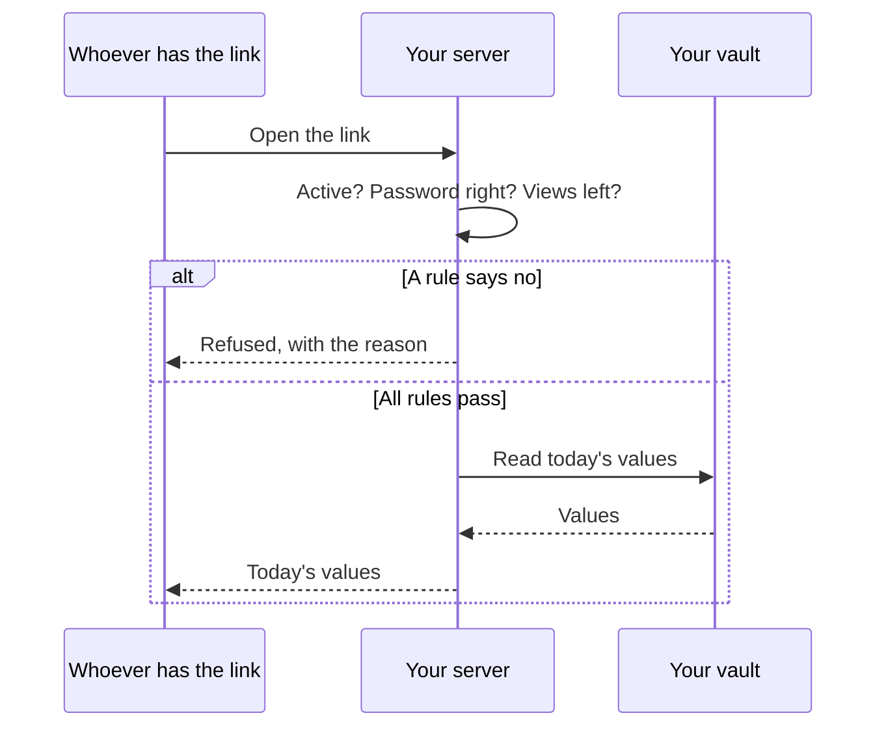

# Lab: Share

Build a link you'd really send: with a password, a limit and a watermark. Then
watch each rule do its job. It takes about 10 minutes.

**You need** the app, signed in. [Try it in 5 minutes](../try/index.md) gets you
there.

<video controls preload="none" playsinline poster="https://revoked.link/video/film-share-wide.jpg" style="width:100%" aria-label="A short film showing how to share records, decide who gets in, watermark files and revoke a link. It has no sound.">
  <source media="(max-width: 599px)" src="https://revoked.link/video/film-share-tall.mp4" type="video/mp4">
  <source src="https://revoked.link/video/film-share-wide.mp4" type="video/mp4">
</video>

## 1. Pick what to share

Add two records to your vault:

| Label | Value |
|---|---|
| `Server address` | `ssh.example.com` |
| `Server password` | `first-password` |

Mark `Server password` as **Hidden**. The app masks it until you reveal it.

Now choose **New → Share link** and pick both.

**You should see** the label filled in for you, and an expiration date 30 days
from now.

## 2. Decide who gets in

Set these, then create the link:

| Option | Where | Enter |
|---|---|---|
| **Password** | On the form | `lab-password` |
| **Maximum views** | Under **Advanced** | `3` |

Copy the link. The last part is its address. Below, use yours in place of
`k7Qx…`.

## 3. Watch the password work

```bash
curl "https://api.revoked.link/s/k7Qx….json"
```

**You should see** a refusal, and no values:

```json
{ "message": "This link is password-protected. Add ?password=YOUR_PASSWORD to view it.",
  "protected": true, "requiresPassword": true, "slug": "k7Qx…" }
```

A refused read doesn't use up a view.

Now send the password:

```bash
curl "https://api.revoked.link/s/k7Qx….json?password=lab-password"
```

**You should see** both records.

## 4. Watch the limit work

Run the last command until it stops working.

**You should see** `link_revoked` once the three views are used up. The link
revoked itself. Even people opening it at the same moment can't get past the
limit.

## 5. See who sent it

Make a new link to the same records. Under **Advanced → Verification**, choose
**Sign with one of your identities**.

Open the link in the app, with **New → Open or scan a link**.

**You should see** the result of the check before anything else, together with
the reason. On the test server, it should read **DNS verified**. Without the
signature, nobody can check where a link came from.

## 6. Watermark a file

Add a file to your vault: an image or a PDF. Choose **New → Share link**, pick
the file and, under **Advanced**, enter `For Northwind` as the **Watermark**.

Open the link in a browser and download the file.

**You should see** `For Northwind`, the date and a short tag such as `#a3f9c1`
across the whole page. The same tag shows on the share, so a leaked copy tells
you which link it came through. Your own file stays unchanged.

## 7. Read it from other tools

A share also opens in the tools people already use:

| Add to the address | You get |
|---|---|
| `.json` | JSON |
| `.csv` | A spreadsheet |
| `.vcf` | A contact card |
| `.ics` | A calendar, for records with a date |

```bash
curl "https://api.revoked.link/s/k7Qx….csv"
```

```text
server_address,server_password
ssh.example.com,first-password
```

## What just happened

Nothing was ever sent to anyone but the link. Each read goes back to your vault,
so the rules are checked on every open.



## If something doesn't match

| What you see | What to do |
|---|---|
| `link_expired` | The expiration date has passed. Make a new link. |
| `link_revoked` straight away | This link has used up its views. **Duplicate** makes a new link with the count back at zero. |
| Your file isn't served | A watermarked share only serves images and PDFs. Other files can't be stamped, so they're left out. |
| The app says **Not verified** | The domain has no DNS record yet, or the identity is older than this check. On your own server, [publish the DNS record](../installation/dns.md). |

## Next

- [Sharing](../guide/sharing.md) has every option.
- [Lab: Collect](collect.md) does the same thing the other way round.
