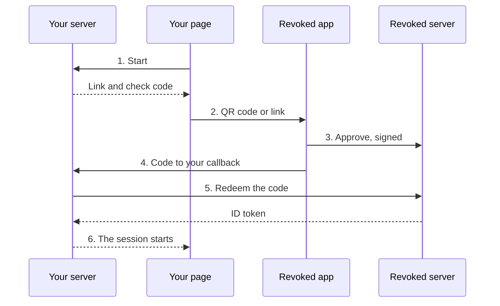

# Lab: Sign in

Run Corner Shop, a small service with no accounts and no passwords. Sign in, share
a delivery address, change it, and take it back. It takes about 15 minutes.

**You need** the app, signed in, on the same computer as the shop. You also need
Node 22 or later.

<video controls preload="none" playsinline poster="https://revoked.link/video/film-signin-wide.jpg" style="width:100%" aria-label="A short film showing how people sign in to a service with their Revoked account. It has no sound.">
  <source media="(max-width: 599px)" src="https://revoked.link/video/film-signin-tall.mp4" type="video/mp4">
  <source src="https://revoked.link/video/film-signin-wide.mp4" type="video/mp4">
</video>

## 1. Add an address to your vault

Add a record to your vault, with `shipping_address` as its key. To pick the key
yourself, open **Advanced**.

| Label | Key | Value |
|---|---|---|
| `Home` | `shipping_address` | `Musterstraße 12, Berlin` |

## 2. Start the shop

```bash
cd examples/sign-in-demo
npm install
cp .env.example .env
npm start
```

Open <http://localhost:4000>.

**You should see** the shop, with a **Sign in with Revoked** button. You
registered nothing, and there's no client secret. The shop's address is all it
needs.

## 3. Sign in

Press the button.

**You should see** a panel with a QR code, a link for this device and a short
code such as `0D2-99B`. Open the link.

## 4. Choose what the shop learns

**You should see** **Sign in to localhost** in the app, and the same code. Only
continue if the two match. That's how you know this sign-in is the one you just
started.

Under **localhost may read**, pick your entry for `shipping_address`. Choose
**Don't share** for `phone`. Press **Sign in**, and confirm.

## 5. See what the shop received

Go back to the shop's page. It carries on by itself.

**You should see** that you're signed in, and your address. The shop keeps it for
no longer than your server allows, and it has no address column.

Behind the scenes, it read the address from your server:

```json
{
  "sub": "4kS0…",
  "revoked_links": {
    "endpoint": "https://api.revoked.link/api/grants/resolve",
    "grants": [ { "id": "q8w2…", "token": "…", "keys": ["shipping_address"] } ]
  }
}
```

`sub` is an ID made just for this shop. Sign in to another service, and it gets a
different one, so services can't match their users.

## 6. Change your address

In your vault, change the value to `Hauptstraße 3, Köln`. Wait about a minute, and
reload the shop.

**You should see** the new address. You didn't sign in again or tell the shop
anything.

## 7. Take it back

Open **Settings → Connected tools**.

**You should see** `localhost` under **Services you signed in to**, with what it
learned and your shared entry.

!!! note "This list needs a recent server"
    **Services you signed in to** arrived in `v0.30.0`. If it's missing, the
    server or the app is older than that.

Open it, tap the link under **Shared entries**, and choose **Revoke**. Reload the
shop.

**You should see** that the address is gone. You're still signed in, because the
shop keeps its own session. To sign out, you sign out at the shop.

## Add it to your own service

You need two lines for the button and three routes on your server. Copy
`revoked-sign-in.js` from `examples/sign-in-button` next to your static files:

```html
<script type="module" src="/revoked/revoked-sign-in.js"></script>
<revoked-sign-in start="/auth/revoked/start" wait="/auth/revoked/wait"></revoked-sign-in>
```

Corner Shop's `server.js` and `signins.js` have all three routes running. Read
[Add it to your service](../api/sign-in.md#add-it-to-your-service) for what each
one does.

## What just happened

The app is where every sign-in is approved. Your browser never sees a password,
and your service never holds one.



## If something doesn't match

| What you see | What to do |
|---|---|
| The link does nothing | The app isn't registered for `revoked://` links. See [Install the app](../installation/app.md). |
| Scanning with a phone fails | On `localhost`, the app has to run on the same computer. To use a phone, set `PUBLIC_URL` to an address it can reach. |
| The codes don't match | Stop. Start signing in again on the page you meant to use. |
| No address on the page | You chose **Don't share**, or there's no entry with that key. Sign in again and pick one. |
| The old address stays | The shop may keep a value for up to `maxAge` seconds. Wait a little and reload. |

## Next

- [Sign in with Revoked](../api/sign-in.md) has the full flow, scopes and claims.
- [How it works](../how-it-works/index.md) shows all the flows side by side.
